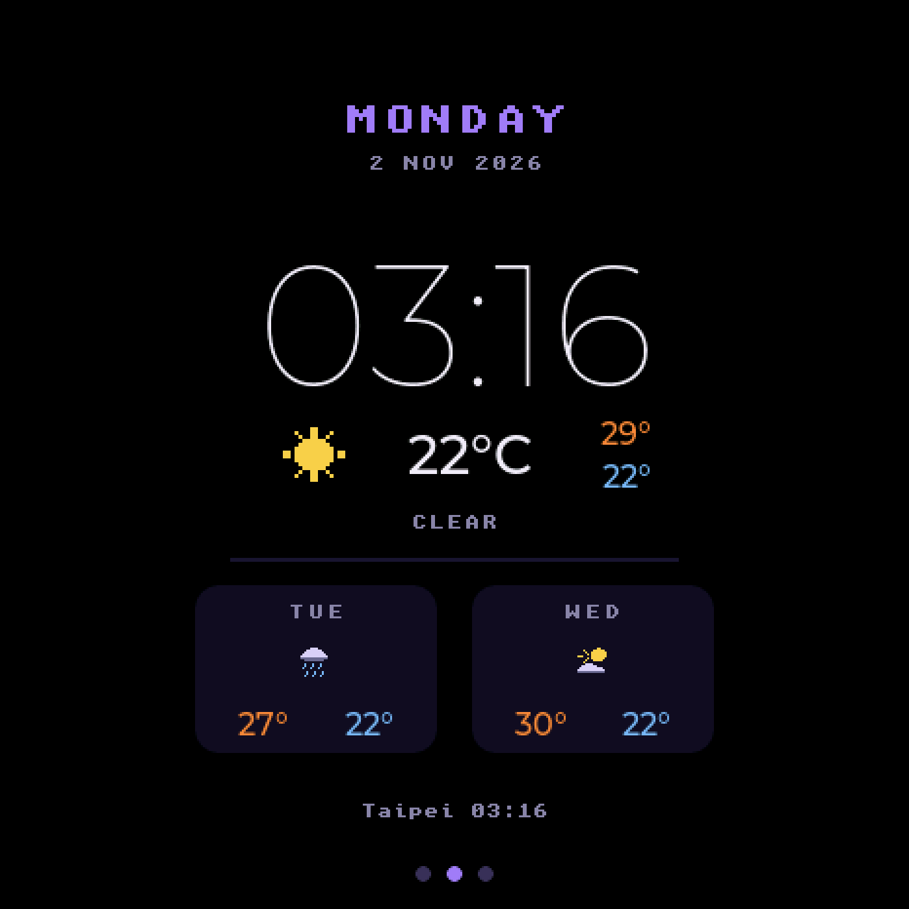

# Clock and weather page

A swipe page for a Muse gadget showing the time, the date and a three-day
forecast. Drop the folder in and it appears between the character and
settings — no edits to the firmware's own files.



## What it shows

- The weekday, the date and the time, the time in a Montserrat face cut down
  to the eleven glyphs a clock needs.
- Now: a sky icon, the temperature, and today's high and low.
- The next two days: weekday, sky icon, high and low.
- Where the forecast is for, and when it last arrived.

## Installing it

Copy `muse_clock/` into `esp32/components/` of your checkout, or keep it
somewhere else and point the build at it:

```
idf.py -DEXTRA_COMPONENT_DIRS=/path/to/muse_clock build
```

Then set where you are. Everything is under **Muse clock page** in
`idf.py menuconfig`, or straight into your board's overlay in
`esp32/devices/`:

```
CONFIG_MUSE_CLOCK_LATITUDE="25.0330"
CONFIG_MUSE_CLOCK_LONGITUDE="121.5654"
CONFIG_MUSE_CLOCK_PLACE="Taipei"
CONFIG_MUSE_CLOCK_FAHRENHEIT=n
CONFIG_MUSE_CLOCK_24H=y
```

`CONFIG_MUSE_CLOCK_ENABLED=n` leaves the page out of the build entirely, and
settings goes back to being one swipe from the character.

Build and flash as usual:

```
tools/muse/board.sh build s3 && tools/muse/board.sh flash s3
```

## What it talks to

**Open-Meteo** for the forecast, over HTTPS. There is no account to make and
no API key to leak — the forecast endpoint is open, and the free tier is for
non-commercial use. One request every 20 minutes, a few KB each.

**pool.ntp.org** for the time, over SNTP. Change it with
`CONFIG_MUSE_CLOCK_NTP_SERVER`.

The timezone is not configured anywhere. Open-Meteo is asked for the forecast
with `timezone=auto` and answers with the location's own UTC offset, which is
what the clock runs on. Move the coordinates and the clock follows.

With no Wi-Fi the page says so and keeps the last forecast on screen rather
than blanking it.

## How it attaches itself

Nothing in the firmware calls into this component. It declares a page and
hands it over with `MUSE_PAGE` from `muse_page.h`:

```c
static const muse_page_t clock_page = {
    .name = "clock", .build = build, .tick = tick,
};
MUSE_PAGE(clock_page);
```

That registers the page from a constructor, before `app_main`, so the UI has
it by the time it builds the screen. The one thing to copy if you write your
own page: `idf_component_register(... WHOLE_ARCHIVE)`. Nothing references the
component by name, so a plain archive would be dropped at link time and the
constructor with it.

`build()` is handed an empty tile once, with the LVGL lock already held.
`tick()` runs about once a second and is told whether the page is the one on
screen, so it can skip redrawing what nobody is looking at. Both run in the
LVGL task, so the forecast is fetched on a task of its own (`muse_weather.c`)
and the page only ever reads the last answer.

Up to `MUSE_PAGES_MAX` pages can register. Each one costs a swipe to reach
settings, which is why that number is small.

## Regenerating the clock face

`fonts/muse_font_clock_88.c` is checked in, so you only need this to change
the size:

```
tools/gen_clock_font.sh 72
```

It pulls Montserrat from Google's fonts repository and runs `lv_font_conv`
over the digits and the colon — eleven glyphs, because a full face at this
size would be most of a megabyte and the page never shows a letter in it.

## The weather icons

`muse_clock_icons.h` holds them as string art, one letter per pixel in a
16×16 grid, scaled up into ARGB8888 at run time. Editing one is editing the
picture in the source. The letters are listed at the top of that file.

## Licence

Apache 2.0, the same as the rest of the Muse Gadgets SDK.
