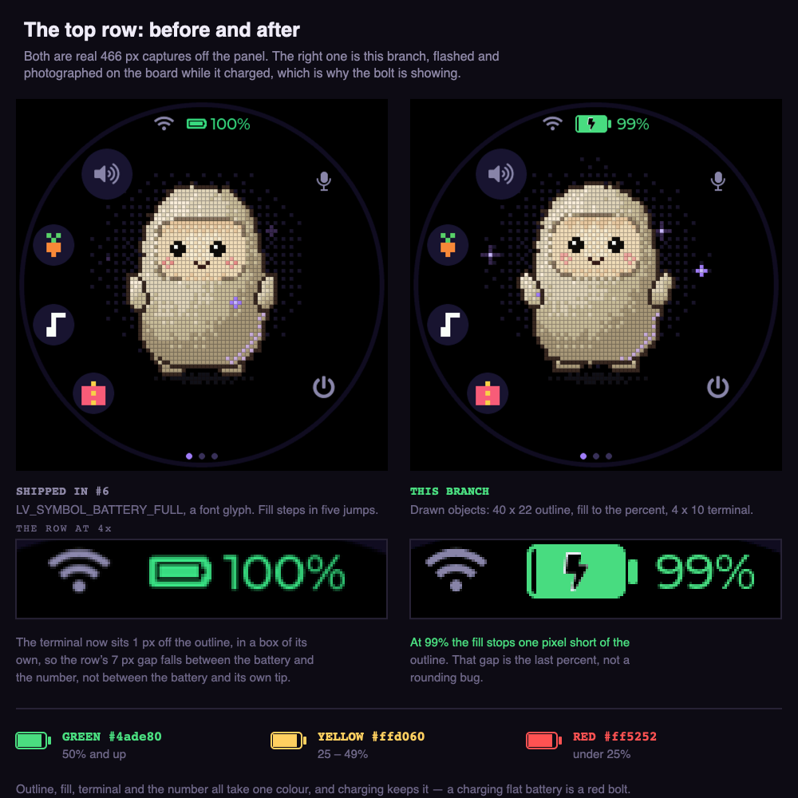
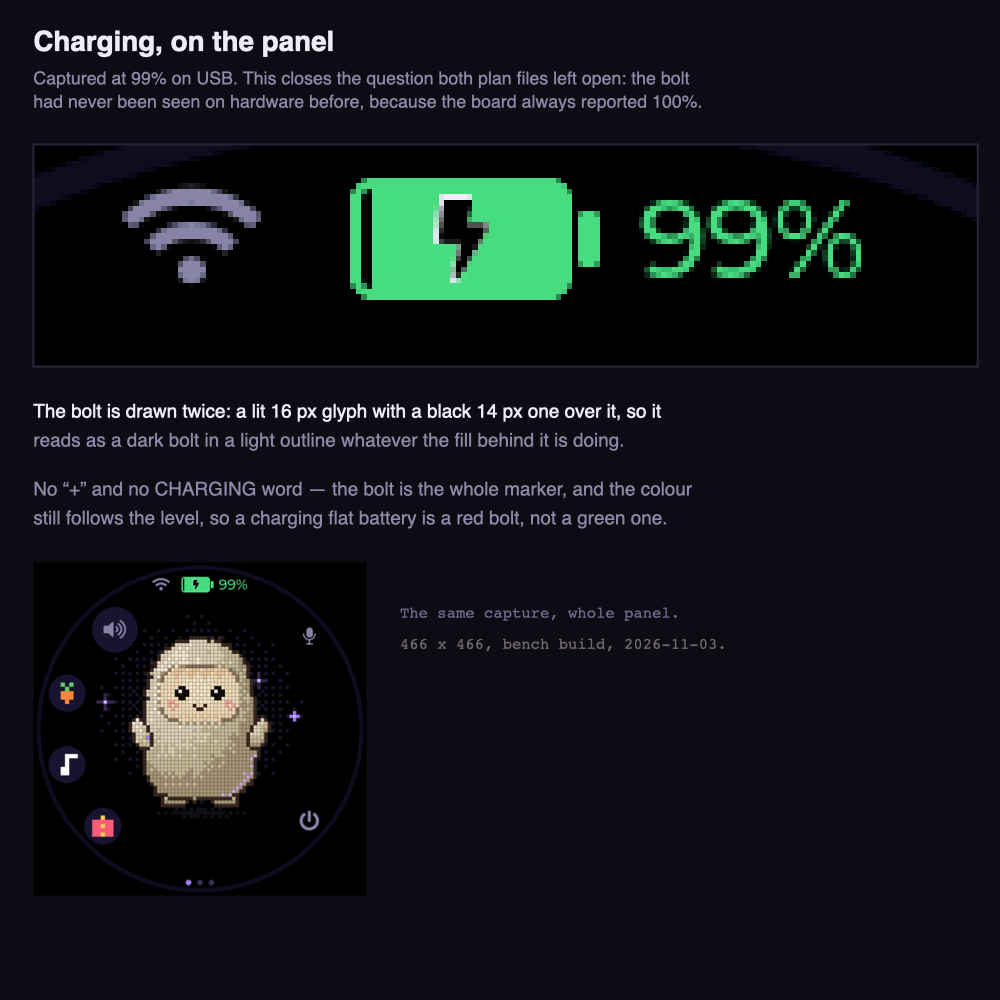

# Battery icon on the first page

**Status:** working, verified on hardware
**Branch:** `feat/battery-top-icon` — merged to `main` in #7
**Last updated:** 2026-11-03

**Note on the images:** all four PNGs are on the branch, added from a
local checkout — the GitHub MCP file tools cannot push binary PNGs (a
test upload stored base64 text instead of PNG bytes and was removed
again). `battery-top.png`, `battery-charging.png` and
`battery-capture.png` are **real captures** of this branch running on
the board. `battery-states.png` is still a mockup: the bands below 50%
cannot be forced on a bench board. The `battery-page1.png` the text
used to point at never existed and is no longer referenced.

## Rework on top of PR #6 — read this first

While the original battery-top-icon branch was blocked on GitHub
permissions, PR #6 (`feat/status-row`) merged a battery icon of its own
into `main` (now at `3c610d4`): an LV_SYMBOL battery with stepped fill,
green `0x3ddc84` / yellow `0xffcc33` / red `0xff5252`, a charge marker
in front of the symbol, and `idle_name()` returning `""` when Wi-Fi is
connected so no `READY` shows.

This branch is a rework **on top of that merged code**, not a revert of
it, chosen by the user on 2026-11-03 after seeing both versions. It
keeps PR #6's status-row font (`FONT_STATUS`, Montserrat 20), its
`idle_name()` READY behaviour, and its compact-layout text, and
replaces only the full-layout battery display with the custom box icon
below: a 40 x 22 px outline with proportional fill, the original spec
colours (`#ff5252` / `#ffd060` / `#4ade80`), and a lightning bolt
**inside** the icon while charging. The READY rule in the next section
is therefore already satisfied by the merged `idle_name()` — the
hide-the-label approach from the first version of this branch is not
re-applied, because the merged code never puts `READY` in that slot
when Wi-Fi is connected.

## Goal

Show the battery as a coloured icon plus its percentage on the first page
— the Jolly face — in the top status row, next to the Wi-Fi icon, so the
charge is visible at a glance without swiping anywhere, and large enough
to read.

This supersedes two earlier proposals, both mocked up then dropped — do
not implement either:

- A battery indicator at the top-right of the clock/weather page
  (page 2).
- A battery icon centred at the bottom of the first page, above the page
  dots. That version is superseded by the top-row version below, because
  the top row is where the battery already lives and a second copy at the
  bottom would duplicate it. That bottom mockup was never committed and
  is not kept.

## What it looks like

Both panels below are real captures: PR #6's row on the left, this
branch's on the right, with the row itself blown up to 4x underneath.
The `READY` line and the `BATTERY 100%` text went in #6; what changes
here is the icon itself, from an `LV_SYMBOL` glyph to objects drawn at
40 x 22.

When charging, the battery keeps its percentage colour and gains a
lightning bolt inside the icon, and the percentage still shows the
current charge. Captured at 99% on USB:

The colour is the percentage, not a separate status. This one is a
mockup — a bench board on USB will not drop below 50% to order:

| Percentage | Colour | Hex |
|---|---|---|
| Under 25% | Red | `#ff5252` |
| 25% to under 50% | Yellow | `#ffd060` |
| 50% and over | Green | `#4ade80` |

The boundaries are as written: 25% is yellow, 50% is green. The icon's
outline, its fill and the percentage text all take the same colour; the
fill is proportional to the percentage. Charging does not change the
colour — a charging battery at 12% is still red, with a bolt.

## Placement, as drawn

For the 466 x 466 round panel, in the top status row that
`build_screen()` already builds:

- One centred row: Wi-Fi icon, then battery icon, then percentage.
  Wi-Fi about 28 px wide, battery icon **40 x 22 px**, percentage in a
  20 px font, about 7 px between icon and text.
- The row sits where the old status row sat (top offset about 20 px),
  grown to roughly 24–28 px tall. It does not move the avatar, the pet
  buttons, the caption or the three page dots.
- The widget must be a child of the **face tile**, not a screen overlay.
  The dots are a screen overlay and show on every page; a screen-overlay
  battery would wrongly follow the user onto the clock and settings
  pages.

## The READY rule

`READY` is not a decorative label: it is the idle mode name, and the
same label slot carries other idle states. Removing it outright would
also remove `SET UP WI-FI`, `NO WI-FI`, `CONNECTING` and `RECONNECTING`
when the gadget is not connected, and `LISTENING` / `THINKING` /
`SPEAKING` in the other modes.

So the rule is narrower:

- **Hide the state label only when the mode is idle and Wi-Fi is
  connected** — the case that today reads `READY`. That is the normal,
  paired, idle screen, and it is where the larger top row needs the
  room.
- **Keep the label in every other case:** idle but not connected
  (`SET UP WI-FI`, `NO WI-FI`, `CONNECTING`, `RECONNECTING`, `WI-FI
  OFF`), and every non-idle mode (`LISTENING`, `THINKING`, `SPEAKING`,
  `ERROR`, `WAKING UP`, `GOODBYE`).

When the label is hidden in idle, nothing else moves up to fill its
place; the space is simply the breathing room that lets the top row be
larger.

## Charging

- `muse_power_t.charging` is already available alongside the percentage.
- When charging is true, draw a lightning bolt centred inside the
  battery icon, on top of the fill, and keep showing the current
  percentage in the threshold colour.
- Draw the bolt so it reads on both parts of the icon: a lit outline
  with a panel-black fill, so the bolt is visible over the coloured
  fill and over the empty part of the icon alike.
- Do not add a second charging word or a `+` next to the percentage:
  the bolt is the charging marker.

## Plan

1. In `build_screen()`, replace the top status line's power label with
   the battery icon + percentage widgets, at the size above, and enlarge
   the Wi-Fi icon to match. Keep the Bluetooth icon as it is.
2. In `update_status()` / the state-label update, hide the state label
   only for idle + Wi-Fi connected, as in the READY rule above.
3. In the existing 1-second power update (`update_power()`), set the
   icon fill, the icon colour, the percentage text and the bolt from
   `muse_state_power()`, using the colour table above.
4. Hide the whole battery group when `battery_pct` is −1 (no battery
   reading). For that case, keep the old `USB POWER` fallback in the
   status row, so a USB-only board still says something about power.
5. Build, then verify on the panel with real captures: each colour band,
   a charging battery (bolt visible, percentage still correct), an idle
   connected screen with no `READY`, and a disconnected screen that
   still shows `SET UP WI-FI` / `NO WI-FI`. A mockup is not a
   verification.

Steps 1, 3 and 4 are implemented in `feat/battery-top-icon` on top of
`main` at `3c610d4` (`esp32/components/muse/muse_ui.c`: the top status
row and `update_power()`); step 2's READY outcome is already in place
via PR #6's `idle_name()`. Step 5 is still open: this branch has not
been built for a board or captured on a panel yet, so do not call it
working until that happens.

## Findings

- **The first page already showed the battery percentage, as text at
  the top.** `build_screen()` builds a status line (Wi-Fi icon,
  Bluetooth icon, power label) at the top of the face, and
  `update_power()` writes `BATTERY 100%` / `CHARGING 100%` into it on
  the full UI. The `pet-food.png` capture shows it. The old text was
  in an 8 px font next to a 14 px Wi-Fi symbol, which is why it read as
  too small — *(how: read `muse_ui.c`, then looked at the capture)*.
- **READY is the idle mode name, not a fixed caption.** `MODE_NAMES`
  and `idle_name()` in `muse_ui.c` put `READY` in that slot only when
  Wi-Fi is connected; the same slot shows the Wi-Fi problem states
  when it is not, and the other mode names otherwise — *(how: read
  `muse_ui.c`)*.
- **The data already exists.** `muse_power_t` in `muse_state.h` carries
  `battery_pct` (−1 when no battery is connected), `battery_mv`,
  `charging` and `usb`, fed by each board's `read_power()`. No new
  sensor or board work is needed for the percentage or the charging
  state — *(how: read `muse_state.h` and the board files)*.
- **Scope is the 466 px full UI.** Compact/small layouts use a smaller
  status row and a caption band over the bottom of the face; their
  sizing is out of scope until checked, not assumed to fit.

## Blockers

None — only the confirmation in the open question below.

## Open questions

None on placement.

- **Confirmed 2026-11-03: top only, drop the bottom icon.** The bottom
  icon from the previous version is not to be implemented, and its
  mockup was never committed.

- **Verified on hardware 2026-11-03.** Flashed as a bench build
  (3,477,504 bytes, the same size as `main`) and captured at
  `assets/battery-capture.png`. The spacing reads correctly: the
  terminal belongs to the battery, and at 99% the fill stops one pixel
  short of the outline, which is the last percent rather than a
  rounding bug.

- **The charging bolt is confirmed.** Both this plan and
  [status-row.md](status-row.md) listed it as never seen, because the
  board reports 100% on USB and so never enters the charging state. It
  was at 99% when this capture was taken, and the bolt rendered as
  designed — a dark bolt in a light outline over a green fill.

- **The bands under 50% are still unseen.** Red and yellow have never
  rendered on the panel; a bench board on USB stays near full. The
  colour maths is three comparisons, but the contrast against the black
  panel has not been judged by eye.

## References

- `esp32/components/muse/muse_ui.c` — `build_screen()` (face tile and
  top status line), `build_overlays()` (the three page dots),
  `update_power()` (the existing 1-second power update),
  `update_status()` / `idle_name()` (the state label and the READY
  rule)
- `esp32/components/muse/muse_state.h` — `muse_power_t`,
  `muse_state_power()`
- `plan/assets/status-row-after.png` — PR #6's row, the "before"
- `plan/assets/battery-capture.png` — the raw 466 px capture of this
  branch on the board, 2026-11-03
- `plan/assets/battery-top.png` — both captures side by side, row at 4x
- `plan/assets/battery-charging.png` — the charging bolt, from the same
  capture
- `plan/assets/battery-states.png` — mockup: the three colour bands
- [status-row.md](status-row.md) — PR #6, which this reworks
