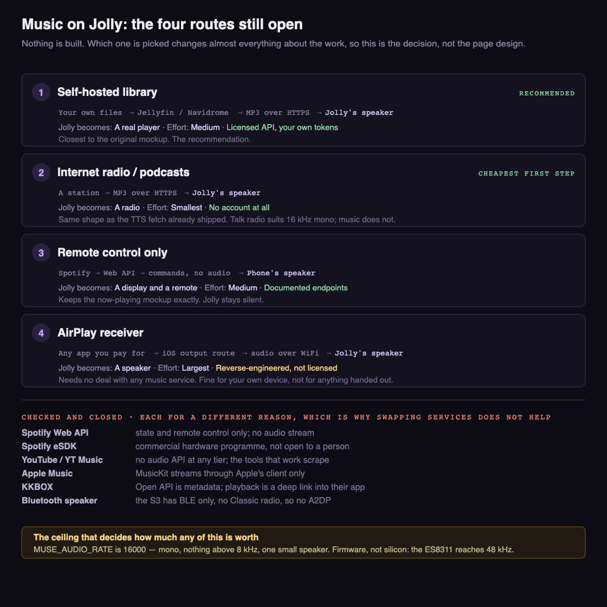
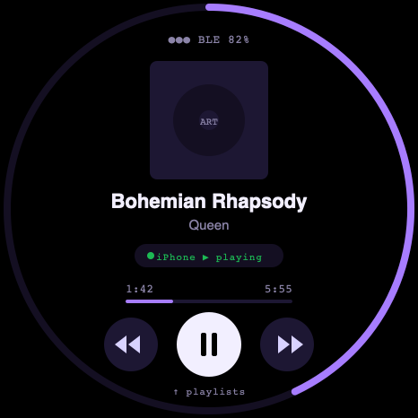
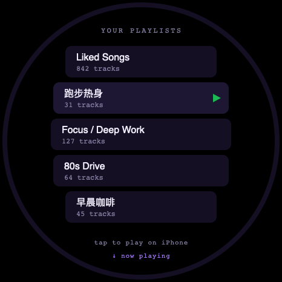

# Music / now playing

**Status:** route 2 picked — see radio.md
**Branch:** TBD
**Last updated:** 2026-11-05

## Goal

Play music on Jolly. The original shape was a Spotify page: what is playing,
and a playlist list to pick from.

## The decision this is waiting on

Four routes are open and three of them make a different product. This is the
whole of it on one page — where the bytes come from, what Jolly turns into,
and what is closed and why:

**Picked 2026-11-05: route 2, internet radio and podcasts.** The page, the
decisions and what they cost are in [radio.md](radio.md). The other three
stay above as the alternatives that were open at the time.

## Mockup

The original shape — a Spotify page — drawn at the real 466 x 466 in the
firmware's own palette. It is the picture of **route 3**, and it is also
roughly what route 1 would look like with different row contents. Nothing is
built.

## Findings

- **No major streaming service will license audio to a device like this.**
  Checked one at a time, and they fail for different reasons, which is why
  swapping services does not help:
  - **Spotify Web API** exposes playback *state* and *remote control* of a
    device already running a Spotify client. It hands out no audio stream.
    (Its 30-second preview URLs were withdrawn in the February 2026 changes.)
  - **Spotify eSDK**, which does stream, is a commercial program: you apply as
    a hardware company, sign an agreement, and ship certified hardware. Not
    available to an individual project.
  - **YouTube / YouTube Music** have no audio API at any tier. A Premium
    subscription changes nothing about this; there is no supported endpoint
    that returns an audio stream, and the tools that produce one work by
    scraping, against the terms of service.
  - **Apple Music** has MusicKit, which also only streams through Apple's own
    client on Apple platforms. There is no bare-metal path.
  - **KKBOX** (the Taiwanese service) is the same wall. Its Open API is
    metadata: the official JavaScript and Python SDKs both describe themselves
    as access to metadata for tracks, albums, artists, playlists and stations.
    Full playback goes through KKBOX's own app via a deep link, which is
    platform-restricted. Caveat: the clearest write-up of the deep-link
    behaviour is about nine years old, and developer.kkbox.com could not be
    read (the page is JavaScript-rendered and returns empty), so the current
    terms are unconfirmed. Directional, not established.
- **A paid subscription does not help.** Every one of these grants a *listening*
  right through the provider's own client. None grants a decoding right to
  third-party firmware, so holding Premium on both Spotify and YouTube does not
  unlock anything here.
- **The ESP32-S3 cannot be a Bluetooth speaker.** It has BLE only — no
  Bluetooth Classic radio, therefore no A2DP, which is the Classic profile that
  "Bluetooth speaker" means. Not merely unimplemented: the radio is absent —
  *(how: the S3 datasheet; Espressif's ESP-ADF docs describe the S3 as
  Bluetooth LE only, supporting neither Classic nor LE Audio; the maintainer of
  the main ESP32 A2DP library lists S2/S3/C2/C3 as unable to run it)*. The ways
  round it are an external Classic module feeding I2S, or a chip that has
  Classic (the original ESP32, or the ESP32-S31).
- **Over WiFi, though, "the phone streams to the gadget" is open.** AirPlay is
  not Bluetooth and does not need the Classic radio.
  [rbouteiller/airplay-esp32](https://github.com/rbouteiller/airplay-esp32) is
  an AirPlay 2 receiver whose stated requirement is an ESP32-S3 with 8 MB
  PSRAM — exactly this board — and it is active (632 stars, last pushed
  2026-10-27). On iOS, AirPlay is a system-level output route, so Spotify,
  KKBOX, YouTube or anything else would play to the gadget without knowing what
  it is. [cspot](https://github.com/feelfreelinux/cspot) does the same job as a
  Spotify Connect target with no phone in the path (Premium required, last
  pushed September 2025). **Both are reverse-engineered rather than licensed** —
  fine for one's own device, not for anything handed out.
- **The audio quality ceiling is low, and it decides how much any of this is
  worth.** The Muse audio path is hardwired to **16 kHz mono**
  (`MUSE_AUDIO_RATE 16000` in `esp32/components/muse/muse_audio.h`), through an
  ES8311 into one small speaker — *(how: read the board file and the header)*.
  At 16 kHz nothing above 8 kHz exists: no cymbals, no air, no stereo. The
  ES8311 itself reaches 48 kHz, so the ceiling is firmware, not silicon, but
  raising it means reworking the audio path that voice and TTS share, and the
  driver is still a tiny one in a sealed round puck. As a music speaker this
  will sound like a phone on speakerphone whatever feeds it; as a now-playing
  display and remote it is genuinely good.
- The MP3 decode path proven in [voice.md](voice.md) works and is reusable for
  any audio that can be fetched over HTTPS. The decoder is not the problem;
  **where the bytes come from legally is the problem.**

## Blockers

- ~~Blocked on a decision, not on code.~~ **Resolved 2026-11-05**: route 2.
  The four shapes above are kept as the alternatives that were open; see
  [radio.md](radio.md) for what was built on the one chosen.

## Open questions

- **Which way out?** Four that are actually open, drawn above:
  1. **Self-hosted library** — Jellyfin, Navidrome or any Subsonic server.
     Official HTTP APIs, real tokens, and the server transcodes to MP3, which
     drops straight into the existing decode path. This is the one that most
     resembles the original mockup, and it is the recommendation.
  2. **Internet radio / podcasts** — plain MP3 over HTTPS, no account at all.
     Smallest amount of work; no playlists of your own.
  3. **Remote control only** — keep the now-playing mockup, drive playback on
     the phone through the Spotify Web API, and let the phone make the sound.
     Legal and supported, but the gadget is then a display, not a speaker.
  4. **AirPlay receiver** — the gadget becomes an output the phone can pick, so
     the source stays whatever app you already pay for and the licensing
     question moves off the music service entirely. The largest effort of the
     four, and reverse-engineered. Bounded by the 16 kHz ceiling above unless
     the audio path is reworked too.
- **Of the four, (2) is the cheapest first step by a wide margin.** Internet
  radio is a plain MP3 stream over HTTPS, which is the same shape as the
  `translate_tts` response the TTS work already handles — the HTTPS fetch on a
  worker task, the cross-signed cert verification, minimp3, and a stream buffer
  whose backpressure is demonstrated (535 KB through a 512 KB buffer with no
  overflow). The difference is that a radio stream never ends. Hit FM, ICRT and
  KISS Radio all publish stream URLs. Talk radio also suits a 16 kHz mono
  speaker, which music does not.
- If (1) or (3): the OAuth flow needs a browser and a redirect URI. Where does
  the token live on a device with no keyboard, and how is it refreshed?

## References

- The MP3 decode path proven in [voice.md](voice.md)
- `esp32/components/muse/muse_audio.h` — `MUSE_AUDIO_RATE`, the 16 kHz ceiling
- `esp32/components/muse/boards/board_waveshare_s3_175c.c` — ES8311 speaker,
  ES7210 mics
- [ESP-ADF Bluetooth audio](https://docs.espressif.com/projects/esp-adf/en/latest/solution-center/bluetooth-audio.html),
  [ESP32-A2DP supported hardware](https://github.com/pschatzmann/ESP32-A2DP/wiki/Supported-Hardware)
- [KKBOX JavaScript SDK](https://www.npmjs.com/package/@kkbox/kkbox-javascript-developer-sdk),
  [KKBOX Python SDK](https://github.com/KKBOX/OpenAPI-Python)
- `esp32/components/muse/muse_tts.c` — the HTTPS fetch and stream buffer it uses
