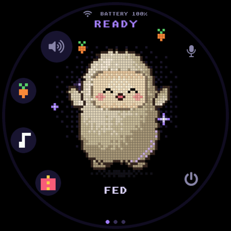
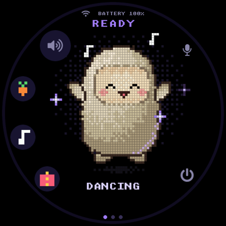
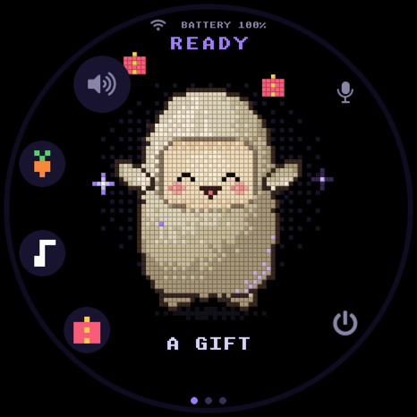
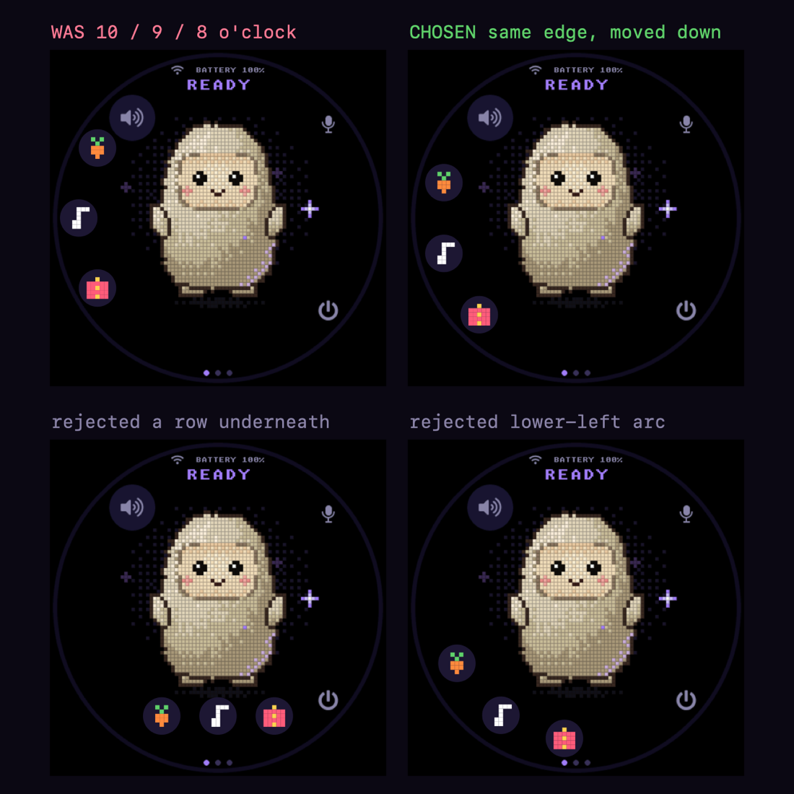

# Digital pet

**Status:** working
**Branch:** `feat/digital-pet` -> `feat/digital-pet-reactions`, PR #4
**Last updated:** 2026-11-01

## Goal

Three buttons on the character's face — food, music and a gift. Pressing one
makes Jolly react: it throws up the matching item, moves, and makes a sound.

## What it looks like

Food, music and the gift, captured off the panel. Each shows the button
column in its chosen position as well as the reaction:

| Food | Music | Gift |
|---|---|---|
|  |  |  |

Leaning into the food with the mouth open mid-chew; swayed over with the feet
off the ground; head down and eyes closed on a nod.

## Where they sit, and the three that lost

Top left is what the first commit shipped. The gap between the carrot and the
speaker is six pixels — one fingertip covers both, which is the whole reason
this round happened. Top right is what was chosen. The bottom two were drawn
and rejected.

The decision page these came from:
<https://claude.ai/artifact/Ds7yfJHJ6ddnFA8P47zmST>

## Decisions

Taken 2026-11-01, after looking at the options on the real screen.

- **Icon colour: keep each item's own colours.** The buttons stay orange and
  green, white and purple, pink and yellow, rather than being flattened to the
  `#8b84a8` that speaker, mic and power use. They are the only coloured
  controls on the face, and that is deliberate: they are play, not system.
- **Position: the same left column, moved down.** The arc shifts from 10/9/8
  o'clock to roughly 9:30/8:30/7:30, which is one constant in `build_answer`.
  Nothing else on the face moves — the dot row and the caption stay where they
  are. This was chosen over a row under the character and a lower-left arc,
  both of which would have meant moving the dots.
- **Sounds: real clips, embedded.** Not synthesised, and not fetched. See
  below.
- **No turning around.** Asked for, and not possible with the art that exists:
  the body is drawn each frame as a procedural shape that always faces the
  viewer, so there is no back to turn to. A spin means drawing a second
  character. The dance is a sway and a hop instead. If a real turn is wanted
  later it is its own piece of work.

## Why the old position was wrong

At 10 o'clock the top button's centre was about 64 px from the speaker's, with
26 and 32 px radii — **a six pixel gap**, so one fingertip covered both. Moving
the column down opens that to about 54 px. *(how: measured off the layout
arithmetic, then checked against the capture above.)*

## The sounds

All three from Pixabay, free under the Pixabay Content License, which covers
embedding in a product and asks for no attribution. Credited anyway.

| Button | Source | Edit | Length | Size |
|---|---|---|---|---|
| Food | *Eating Chips* by 49603404 | Dropped 0.4 s of lead silence, took 2 s, compressed | 2.1 s | 12.7 KB |
| Music | *Ringtone 027* by Universfield | First 2 s, played twice, 60 ms fade on the seam | 4.1 s | 24.6 KB |
| Gift | *Thank you.* by kittenstrike1 | None | 1.2 s | 6.9 KB |

Encoded 24 kHz mono at 48 kbps, matching `test_reply.mp3`, and levelled to
about −18 LUFS so none of them jumps out against a spoken reply.

**The chips clip needed the most work.** It sits at −35 to −50 dB and fades
across its six seconds, which would have been inaudible on this speaker. It is
compressed before normalising so the individual crunches carry — *(how:
measured per-half-second mean volume before and after)*.

## Plan

1. ~~Buttons, icons and the item each one throws up.~~
2. ~~Decide colour and position.~~
3. Move the column down.
4. Embed the three clips and play the right one on each press.
5. Motion per reaction: chewing for food, a sway and hop for music, two nods
   for the gift.

## Findings

- **The character already has the motion vocabulary.** `muse_pixel.c` carries a
  per-mode `bob`, `lean` and `hop`; a reaction drives the same three rather
  than needing anything new — *(how: read the render path)*.
- **Embedding audio is an established pattern.** `test_reply.mp3` ships through
  `EMBED_FILES` in the component's `CMakeLists.txt`, and `m` on the console
  plays it through the real decoder. The three clips come to 44 KB.
- **Flash is the thing to watch.** The image is 3,477,504 bytes of a 4,194,304
  byte slot, 83%, mostly because of the camera feature and the CJK font. 44 KB
  of audio is nothing against the 717 KB left, but the headroom is no longer
  large — measure before adding anything bigger.

## Open questions

- What happens if a reaction's sound lands while a reply is being spoken.
  Proposed: the reply wins and the reaction stays silent, since the reply is
  the thing the user asked for.
- Whether a second press during a reaction restarts it or is ignored.

## References

- `esp32/components/muse/muse_pet_icons.h` — one 5x5 pattern per item, drawn
  both as the button and as the thing that floats up
- `esp32/components/muse/muse_ui.c` — `build_pet_button`, and the angles in
  `build_answer`
- `esp32/avatar/muse_pixel.c` — `draw_items`, and the per-mode motion
- `esp32/components/muse/muse_state.h` — `muse_reaction_t`
