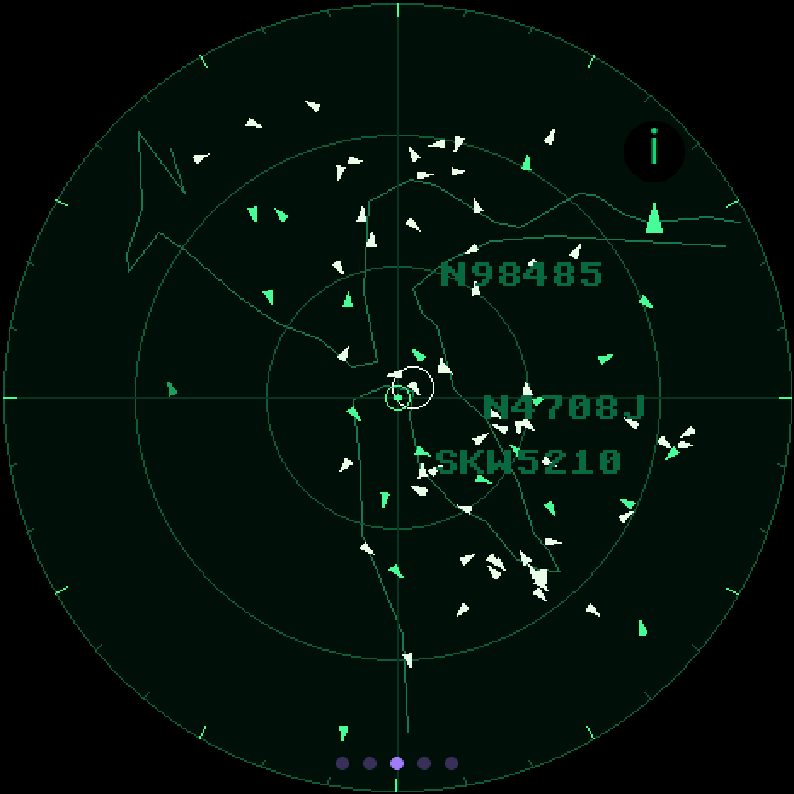
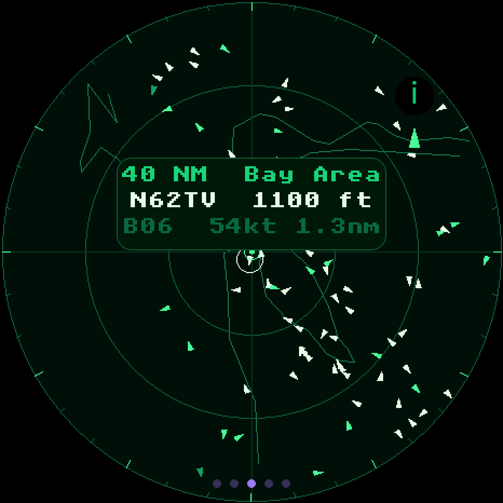
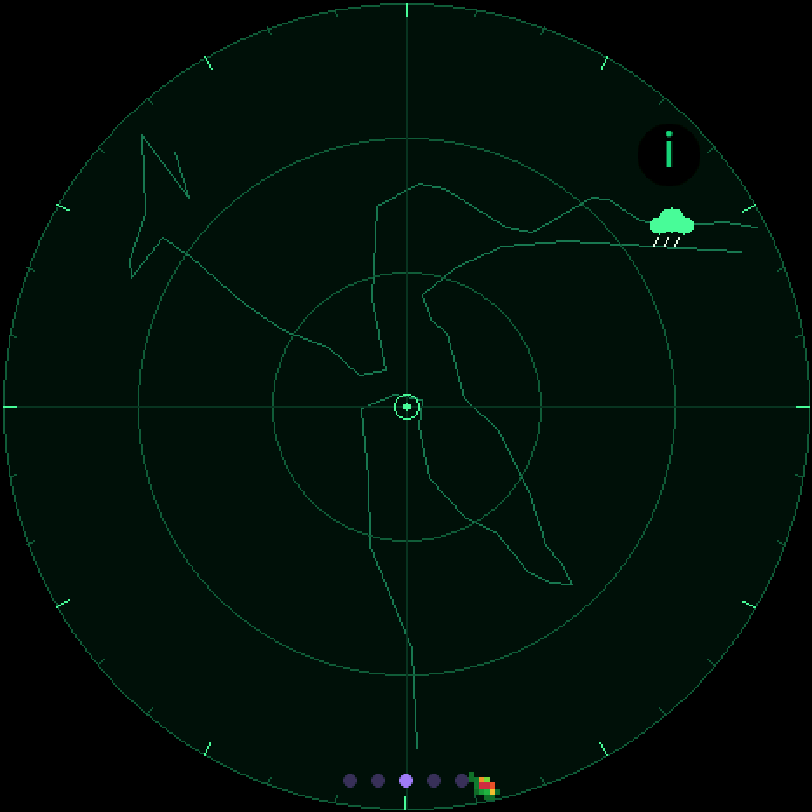
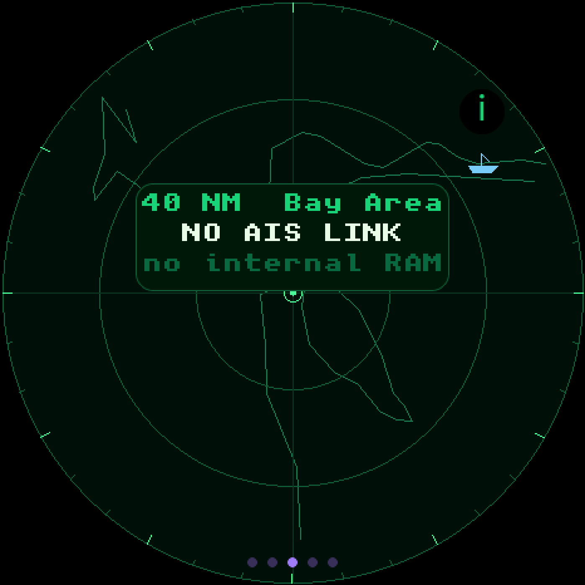
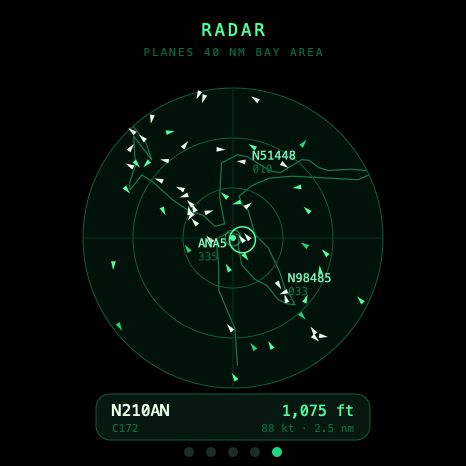
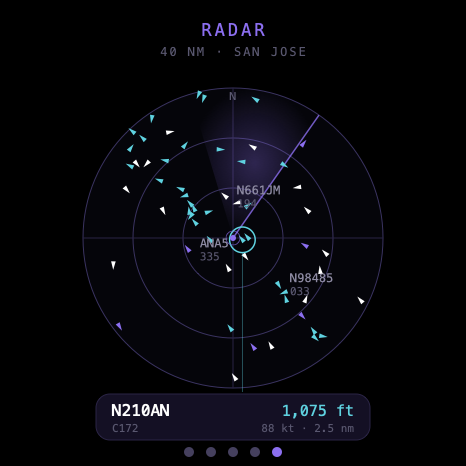
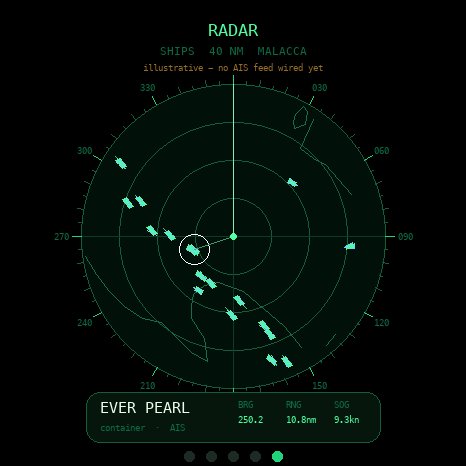
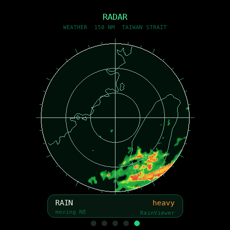
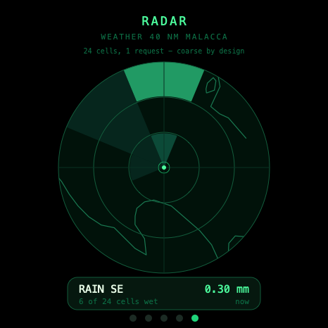
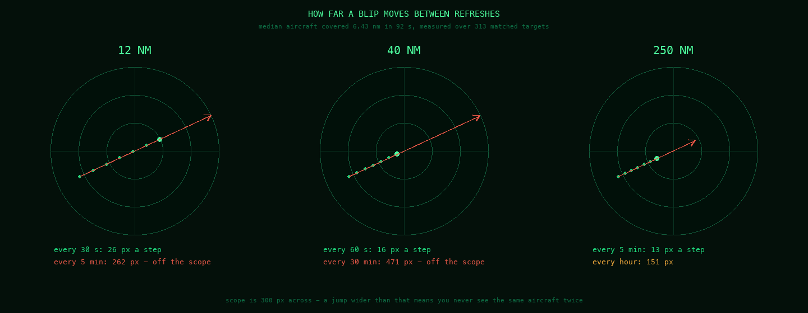

# Radar

**Status:** planes and weather run on the board; ships are blocked on internal RAM
**Branch:** `feat/radar`
**Last updated:** 2026-11-20

## Goal

A swipe page that shows what is moving around a place you care about, drawn as
a radar scope over a coastline: aircraft overhead, ships in a strait, or where
the rain is. One setting picks the range, one picks what to show, one picks the
place, and the range setting's last position is **Off**, which takes the page
out of the swipe list entirely.

## On the board

Flashed to the 1.75C and snapshotted over the serial console on 2026-11-20.
These are the real screens; the mockups that led to them are below.

| Planes | The info card | Weather | Ships, no link |
|---|---|---|---|
|  |  |  |  |

The scope is the page: no title, no permanent caption, no card. It fills the
466 px round display edge to edge. What the captions used to say is behind the
**i** in the top right — placed by the same chord maths as the speaker button
on the face page — which raises a card for five seconds and takes it down
again. Under the icon sits a glyph for what is being shown: an aircraft, a
ship, or a cloud with rain under it, drawn by the same rasteriser as the
blips, because LVGL's symbol font has none of the three.

Measured while they ran:

- **Planes: 80 of 187 aircraft kept** within 40 NM of the Bay Area — the
  80-target cap doing its job on a busy place — *(how: the page's own log line)*
- **Weather: `z=7, 4 of 4 tiles`.** RainViewer tiles decode, reproject and
  recolour on the board — *(how: same)*
- **The PNG decode needs 8 KB of stack.** It overflowed the radar task's
  original 7,168 bytes outright; at 20,480 the high-water mark leaves 12,608
  free. The stack is PSRAM, so the headroom costs nothing scarce — *(how: a
  core dump, then `uxTaskGetStackHighWaterMark`)*
- **Full screen costs 434 KB of PSRAM per layer.** Free PSRAM goes from
  1,961 KB to 1,426 KB when weather allocates its rain layer beside the
  scope — *(how: the link heartbeat either side of a mode change)*
- **Ships do not link on this firmware.** See below; the key is not the
  problem.

### Ships are blocked on internal RAM, not on the key

With a valid key in place the websocket never opens. The reason is specific
and measured:

- `esp_websocket_client` asks for a **6,144-byte task stack**, and creates it
  with plain `xTaskCreate` — *(how: read `xTaskCreate` in
  `esp_websocket_client.c` 1.2.3)*. `xTaskCreate` only ever allocates from
  internal RAM.
- Internal RAM on this build runs at **3–12 KB free with a largest free block
  of 3,200–3,840 bytes** — *(how: `heap_caps_get_largest_free_block` logged at
  each failure)*. A 6 KB contiguous request cannot be met, and TLS will not
  fit in 3 KB either.
- `CONFIG_FREERTOS_TASK_CREATE_ALLOW_EXT_MEM` is already `y`, but it only
  applies to `xTaskCreateStatic`, which this component does not use — *(how:
  read the option's help text in `freertos/Kconfig`)*.

Two things were moved out of internal RAM on the way to finding this, and both
are worth keeping: the 4 KB AIS reassembly buffer now comes from PSRAM, and
the client's own transmit and receive buffers went from 4 KB each to 2 KB,
since AIS position reports are a few hundred bytes. Neither freed a large
enough contiguous block.

What would actually unblock it, in rough order of effort:

1. **Free internal RAM elsewhere in the firmware.** The board runs at
   `min=2K` internal across the whole system, so this is not a radar problem
   and not a radar-sized fix.
2. **Vendor `esp_websocket_client` into `components/`** and change its one
   `xTaskCreate` to `xTaskCreateStatic` with a PSRAM stack buffer, which the
   existing config already permits. Self-contained, but it forks a component.
3. Drop ships.

Until one of those happens the page says `NO AIS LINK / no internal RAM`
rather than looking for contacts that cannot arrive.

Driving it from the bench: `>page=radar:planes` / `:ships` / `:weather`,
`>page=radar:12` / `:40` / `:250` / `:off`, `>page=radar:place=3`, and
`>page=radar:info` to raise the card, since the console cannot tap.

## The AIS key, and where it lives

Ships are the one mode that needs a credential. Planes and weather need none.

1. Sign in at <https://aisstream.io/account> with GitHub — free, no card.
2. **Create API Key**, name it anything (`muse-gadget` does), and copy the
   40-character hex string it gives you. It is shown in full on the account
   page afterwards, so it does not have to be caught on first sight.
3. Put it in `esp32/devices/sdkconfig.local`, which does not exist until you
   make it and is gitignored:

   ```
   CONFIG_MUSE_RADAR_AIS_KEY="your-key-here"
   ```

4. `chmod 600` it and rebuild. `tools/muse/board.sh` appends that file to the
   defaults list last, so it wins over every committed one.

**It must not go in any other config file.** `sdkconfig.defaults` and
everything under `devices/` except `sdkconfig.local` is committed, and a key
pushed to a public repository is a key you have to rotate. The gitignore entry
and the `board.sh` hook exist for exactly this.

Left unset, Ships still draws its scope and says `NO AIS KEY` instead of
pretending to have contacts.

## Mockup

Planes, 40 nm around the Bay Area. Every blip is an aircraft that was really in
the air at 12:28 on 2026-11-20, placed where the API said it was; the coastline
is Natural Earth 50m, clipped and projected the same way the firmware would:



### Green, and a map behind it

Yes to both. Green is the right call and the map is nearly free — the coastline
around a place costs **660–2,400 bytes** as int16 pairs, so every place in the
list together is about 15 KB of flash with no tile server, no projection
library and nothing to download at runtime. At this scale plain
equirectangular is accurate enough; the error over a 250 nm radius is smaller
than a blip.

It does mean the page does not match the violet the rest of the firmware uses.
That is the right trade: this page is pretending to be an instrument, and the
coastline needs a colour the blips can sit on top of without competing. Here is
what it looked like in violet without the map, for comparison — flatter, and
without the coast there is nothing to tell you *where* you are looking:



## What to show

### Planes

Covered below in Findings: keyless, and the API returns range and bearing
already computed.

### Ships — possible, with two catches



Drawn the way a ship's own ARPA display does it, since that is the look worth
copying: a bearing scale in degrees around the rim, own-ship heading line, each
contact as an echo smear with the AIS triangle over it, a vector showing where
it will be in ten minutes, and a dotted past track. The bottom strip carries
bearing, range and speed over ground for the ringed target.

*Illustrative: the contacts are on plausible lane positions, not live AIS.
Everything else in this file comes from real data.*

AIS is a different kind of feed from the plane one. `aisstream.io` is free, but:

1. **It needs an API key** (sign in with GitHub) — a second token to store on
   the device, like the SDK token already is.
2. **It is a WebSocket stream, not a poll.** You connect to
   `wss://stream.aisstream.io/v0/stream`, send a `BoundingBoxes` subscription
   within 3 seconds, and then read continuously or the service drops your
   messages.

The catch that matters: since September 2026 uncompressed connections are
subject to per-user bandwidth limits, so the stream wants `permessage-deflate`.
**ESP-IDF has no permessage-deflate** — `esp_websocket_client` is a managed
component rather than part of the tree, and grepping the local v6.0.1
components for it returns nothing. So ships are not "the same page with
different blips"; they are a websocket client plus a deflate negotiation.

AISHub is not an option at all: it gives API keys only to people who feed it
their own receiver's data.

### Weather — a real radar picture, from a tile



That is live RainViewer data, composited and recoloured exactly the way the
firmware would: one PNG tile, decoded, re-mapped to a green/yellow/red scale,
masked to the scope, with the coastline drawn over it. The rain southwest of
Taiwan was really there when it was sampled.

**This replaces the polar-grid idea, and the reason is a rate limit.** The
first plan was to sample Open-Meteo on a polar grid, since the firmware already
talks to it. Open-Meteo does accept many coordinates in one request — 441
points came back in 150 KB in 338 ms. But its response headers say
`X-RateLimit-Limit: 600` over a 60-second window, and **it bills per location,
not per request**: three test grids in one minute (766 points) took the
remaining quota to zero. A 441-point grid is 441 calls against a 10,000/day
free allowance — about **22 refreshes a day**. Resolution trades directly
against refresh rate, and the resolution you can afford looks like this:



A RainViewer tile costs **one request** no matter how much detail is in it.

What it costs: 11.5 KB for a 256px tile, 32 KB for 512px, no key needed. The
device has to decode PNG (RGBA8, so a 512px tile is 1 MB decoded — PSRAM
territory, not internal RAM) and reproject from Web Mercator, which is a dozen
lines. Zoom is capped: z=7 works, **z=8 returns a "Zoom Level Not Supported"
placeholder image**, so the tightest useful view is about 40 nm across and
12 NM range would be showing a blown-up z=7 tile.

Terms: RainViewer's API is personal and educational use only, with attribution
asked for — hence "RainViewer" in the corner of the mockup. That is fine for a
gadget on a desk and would not be fine for a product.

## Where to point it

All ten places, 250 nm each, sampled the same afternoon:


| Place | Airborne | Verdict |
|---|---|---|
| New York | 1,002 | Too many — 615 KB per refresh |
| Texas (DFW) | 860 | Too many — 476 KB |
| Los Angeles | 583 | Very busy, 375 KB |
| Bay Area | 312 | Busy, 217 KB |
| Hormuz | 46 | Thin for planes, interesting for ships |
| Korea | 34 | Thin — see below |
| Taiwan Strait | 33 | Thin — see below |
| Japan | 33 | Thin — see below |
| Malacca | 20 | The point here is the shipping |
| Panama Canal | 5 | Planes: nothing. Ships: the whole point |

Three things this settles:

- **East Asia is thin because of who is feeding, not what is flying.** Tokyo
  returning 33 airborne aircraft inside 250 nm is not believable — Haneda alone
  moves well over a thousand a day. ADS-B aggregators are fed by volunteers
  with receivers, and there are far fewer of them in Japan, Korea and Taiwan
  than in the US. Cross-checked against a completely separate network,
  `opendata.adsb.fi`, which gave 45 / 43 / 40 for Japan / Korea / Taiwan
  against 468 for the Bay Area — the same ratio. So a Taiwan or Japan radar
  page will look quiet, and that is the data, not a bug. The page should never
  imply it is showing all the traffic.
- **Texas behaves like New York and Los Angeles**: 860 airborne in a 476 KB
  body. The big-metro cap applies to it too.
- **Panama has 5 aircraft.** Picking it in Planes mode is close to an empty
  screen; it earns its place in the list through Ships, and the page should
  say "5 aircraft" rather than look broken.

Ukraine is gone from the list. It returned **zero** aircraft — closed civil
airspace, and military traffic does not broadcast ADS-B — so there was nothing
to show and no fix available on our side.

## Config

One row in the main settings list, as before — it opens the page's own
settings, which is where the three choices live:


- **Range** — `12 NM` / `40 NM` / `250 NM` / `Off`. Note that in Weather mode
  12 NM is a magnified z=7 tile rather than more detail. Off is a real off:
  `muse_page_t.enabled()` is checked before the tile is built, so the page
  leaves the swipe list and its task never starts. No page, no polling.
- **Show** — `Planes` / `Ships` / `Weather`.
- **Place** — the table above.

## How often it refreshes

The proposal was one interval per range — hourly at 250 NM, every 30 minutes at
40 NM, every 1–5 minutes at 12 NM — on the assumption that this keeps clear of
the rate limit. It does, by a wide margin. The problem is the other end: those
intervals are slow enough that the page stops being a radar and becomes a
series of unrelated snapshots.



Measured rather than reasoned: two samples 92 seconds apart over the Bay Area,
313 aircraft matched by hex. The median one moved **6.43 nm**, which is
4.2 nm per minute. The scope is 300 px across. So:

| Range | Crossing time | Proposed | Jump per refresh | Suggested | Jump |
|---|---|---|---|---|---|
| 12 NM | 3.2 min | 5 min | 262 px — off the scope | **30 s** | 26 px |
| 12 NM | | 1 min | 53 px | | |
| 40 NM | 10.7 min | 30 min | 471 px — off the scope | **60 s** | 16 px |
| 250 NM | 66.7 min | 1 hour | 151 px — half the scope | **5 min** | 13 px |

**The direction of the idea is right** — wide views genuinely do tolerate
slower refresh, because a 450 kt aircraft needs 67 minutes to cross 250 NM but
only 3.2 to cross 12 NM. The magnitudes are about 10x too slow. At 40 NM every
30 minutes, each refresh replaces the entire picture: 7% of targets had already
churned in 92 seconds, and over half an hour nothing on screen would be the
same aircraft twice. Of the two options at 12 NM, **1 minute is the right one**
and 5 minutes is not — at 5 minutes a plane enters and leaves between frames.

**The rate limit does not require slowing down, because the page only polls
while it is visible.** At a 30-second refresh, adsb.lol's 500/day buys 4 hours
of looking; at 60 seconds, 8 hours. Nobody watches a desk gadget for 4 hours.
What the limit rules out is background polling, which is already out — and the
freshness worry it was meant to solve is better handled by refreshing **once
when the page becomes visible**, then settling into the cadence above. That
costs one request per visit instead of 24 a day per place.

### It only applies to planes

- **Weather has no choice in the matter.** RainViewer publishes a frame every
  **600 seconds exactly**, and the newest frame was already 5.4 minutes old
  when fetched. Polling faster than 10 minutes re-downloads an identical tile;
  polling hourly skips five frames. So weather is 10 minutes at every range,
  and the range setting changes the zoom, not the cadence.
- **Ships have no refresh interval at all.** AIS over `aisstream.io` is a
  WebSocket stream — positions arrive when vessels transmit, which under the
  AIS standard is every 2–10 seconds for a moving Class A ship. There is
  nothing to poll; the only knob is how often the screen redraws, and a second
  is plenty.

So the setting should not be a user-facing "refresh every N". It should be a
property of the range in Planes mode, fixed at 10 minutes in Weather, and
absent in Ships.

## Plan

1. New component `muse_radar`, modelled on `muse_clock` — own NVS namespace,
   own `MUSE_PAGE`, own settings sub-page. No edits to files upstream touches.
2. A place table of `{name, lat, lon, coastline}` generated at build time from
   Natural Earth by a script in `tools/`, so adding a place is a one-line edit
   and a rebuild.
3. Planes first: `esp_http_client` + `cJSON`, the `muse_weather.c` shape, with
   a cap on aircraft kept.
4. Draw: coastline, rings, blips, the nearest one ringed with a card below.
5. Weather second: one RainViewer tile, a PNG decoder, Web Mercator
   reprojection into the scope, and our own colour ramp over the decoded
   pixels. Check what LVGL's PNG decoder costs in heap before committing.
6. Ships last, and only if the websocket question answers well.

## Findings

- **adsb.lol serves planes keyless over HTTPS.**
  `GET https://api.adsb.lol/v2/point/{lat}/{lon}/{radius_nm}`, 200, no key —
  *(how: curl, 2026-11-20, samples kept for 8 places)*
- **The API does the trigonometry.** Each aircraft carries `dst` (nm from the
  query point) and `dir` (bearing), so a blip is `r = dst/range * R`,
  `θ = dir` — no projection for the blips at all. The coastline *does* need
  projecting, but only once, at build time — *(how: read the fields; checked
  `dir` against an aircraft known to be southwest of Taipei, 242.7°)*
- **500 requests per IP per day**, from `x-ratelimit-limit: 500, 500;w=86400`
  on the live response. Visible-only polling at 30 s buys ~4 hours of watching
  a day — *(how: response headers)*
- **The median aircraft moves 4.2 nm a minute.** Two samples 92 s apart over
  the Bay Area, 313 targets matched by hex: median 6.43 nm, p90 11.8 nm, and 7%
  of targets churned out of the set in that time — *(how: diffed the two
  samples)*
- **RainViewer publishes every 600 s**, 13 frames covering 2 hours, newest
  frame 5.4 minutes old at fetch — *(how: timestamps in weather-maps.json)*
- **Open-Meteo bills per location, not per request.** It accepts many
  coordinates at once (441 points, 150 KB, 338 ms) but the response carries
  `X-RateLimit-Limit: 600` on a 60-second window, and three grids totalling 766
  points in one minute drove `X-RateLimit-Remaining` to 0. Against a 10,000/day
  free allowance a 441-point grid buys ~22 refreshes a day — *(how: response
  headers while testing 100, 225 and 441-point grids)*
- **A RainViewer tile is one request at any resolution.** 11.5 KB at 256px,
  32 KB at 512px, no key, PNG RGBA8. Zoom caps out: z=7 serves data, **z=8
  returns a 1,370-byte "Zoom Level Not Supported" image** — *(how: fetched
  tiles for five places at z=6, 7 and 8 and looked at them)*
- **East Asian ADS-B coverage is roughly a tenth of the US.** Japan 33, Korea
  34, Taiwan 33 airborne within 250 nm against the Bay Area's 312 — and the
  same ratio on an unrelated network (adsb.fi: 45 / 43 / 40 against 468). It is
  feeder density, not traffic — *(how: queried both networks for the same four
  places within a minute of each other)*
- **Coastlines are nearly free.** Natural Earth 50m clipped to 250 nm:
  Bay Area 165 points, Hormuz 200, Taiwan Strait 283, Panama 323, Malacca 532,
  New York 601 — 660 to 2,404 bytes each as int16 pairs — *(how: clipped the
  1.6 MB GeoJSON locally and counted)*
- **`alt_baro` is an int *or* the string `"ground"`.** 98 of 192 aircraft
  within 60 nm of San Jose were parked — *(how: counted in the sample)*
- **New York at 250 nm is 1,199 aircraft in a 615 KB body, Texas 911 / 476 KB,
  and Ukraine 0 in 101 bytes** — *(how: the ten-place sample above, plus
  Ukraine before it was dropped)*
- **ESP-IDF has no permessage-deflate.** Nothing in the v6.0.1 component tree
  matches it, and `esp_websocket_client` is not in the tree at all — *(how:
  grepped `~/esp/esp-idf-v6.0.1/components`)*
- **Two page slots are free.** `MUSE_PAGES_MAX` is 4; only `clock` and `radio`
  register — *(how: `git grep MUSE_PAGE(`)*

## Blockers

- Planes and weather: none, both run on the board.
- Ships: **internal RAM**, not the key. A key is in place and the stream
  still will not open; see "Ships are blocked on internal RAM" above for the
  measurements and the three ways out.
- The app binary is now **3.75 MB in a 4 MB `ota_0` slot**, ~250 KB of
  headroom. Worth watching before the next sizeable feature.

## Open questions

- ~~Does cJSON survive a 615 KB body on this board?~~ Settled by not asking it
  to: the response is parsed as it arrives, one aircraft object at a time, so
  the body is never held. Only the kept targets cost memory.
- **Supplier risk on the plane feed.** `github.com/adsblol/api` was archived by
  its owner on **2026-11-19** and warns a key will eventually be needed;
  airplanes.live has already closed its public API; `api.adsb.one` returned
  403. `opendata.adsb.fi` answered fine with the same field names and is the
  fallback — *(how: curl, all four, 2026-11-20)*. Keep the source behind one
  function.
- Which place is the default? Shipped as Bay Area, Planes, 40 NM — the one
  that looks alive out of the box.
- ~~Does the PNG decoder fit?~~ Yes — libpng's simplified reader, not LVGL's,
  decoding 256px tiles one at a time. See "On the board" above for what it
  cost.
- Should the device recolour the tile, or is RainViewer's own palette good
  enough? It has to decode the pixels either way, so recolouring to match the
  rest of the page is nearly free — the mockup above does it.

## References

- Files to add: `esp32/components/muse_radar/`
- Patterned on: `esp32/components/muse_clock/muse_clock.c`,
  `esp32/components/muse_clock/muse_weather.c`
- Page contract: `esp32/components/muse/muse_page.h`
- Data: [adsb.lol](https://api.adsb.lol/v2/point/), [adsb.fi](https://opendata.adsb.fi/),
  [aisstream.io](https://aisstream.io/documentation),
  [RainViewer](https://www.rainviewer.com/api.html),
  [Open-Meteo](https://api.open-meteo.com/v1/forecast),
  [Natural Earth coastline](https://github.com/nvkelso/natural-earth-vector)
- Prior art: [Alex-developer/ADSB-Radar](https://github.com/Alex-developer/ADSB-Radar)
  (ESP32-P4, same idea, worth reading for the altitude colouring)
