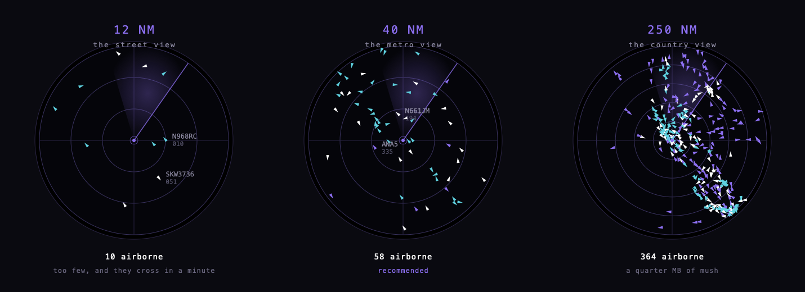
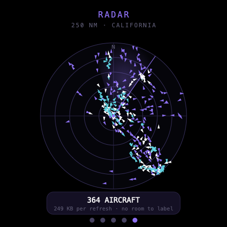
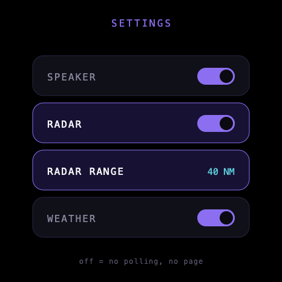

# Radar

**Status:** mockup only
**Branch:** `feat/radar`
**Last updated:** 2026-11-20

## Goal

A swipe page that shows the aircraft actually overhead right now, as blips on a
radar scope: a ring of sky around wherever the clock page says you are, the
nearest one named at the bottom, so a plane you can hear gets a callsign. Off by
default-able — a settings switch that takes the page out of the tileview
entirely, because this one polls somebody else's free API.

## Mockup

The page itself, 40 nm around San Jose, drawn from a real sample taken
2026-11-20 12:28 — every blip below is an aircraft that was actually in the air
at that moment, placed where the API said it was:

Blips are triangles pointing along the track, coloured by altitude (cyan below
5,000 ft, white to 20,000 ft, violet above). The ring highlights the nearest
airborne aircraft and the card below names it.

## City or country: the question, drawn

This was the open question. Same place, same minute, three ranges:

**40 nm wins, and not on taste — on bytes and on movement.**

| Range | Airborne | Payload | Blip speed on screen |
|---|---|---|---|
| 12 nm | 10 | 1.4 KB | ~27 px per 10 s — crosses the screen in a couple of minutes |
| 40 nm | 58 | 31 KB | ~8 px per 10 s — visibly moving, readable |
| 150 nm | 207 | 150 KB | ~2 px per 10 s |
| 250 nm | 364 | 249 KB | ~1 px per 10 s — looks frozen |

The country view is the prettiest of the three and the least useful. At 250 nm
the blips trace the California coast and the SFO/LAX corridor, which is lovely
as a texture, but nothing on it moves at a rate a person watching will notice,
no label fits, and it costs 25x the bytes of the metro view against a budget of
500 requests a day:

The street view fails the other way: ten aircraft, a third of them circling the
same training area, and an empty scope whenever nothing is departing. Around
Taipei the same 10 nm query returned **zero** aircraft.

So: 40 nm default, with the range selectable in the page's own settings for
anyone who wants the state-wide picture.

## Config

Off is a real off: `muse_page_t.enabled()` is checked before the tile is made,
so returning false leaves the page out of the tileview altogether rather than
hiding an empty one — no page, no polling task, no requests.

## Plan

1. New component `muse_radar`, modelled on `muse_clock` — own NVS namespace,
   own `MUSE_PAGE`, own settings sub-page. No edits to files upstream touches,
   so no merge conflicts (the voice merge cost an afternoon over one).
2. Fetch task of its own: `esp_http_client` + `cJSON`, same shape as
   `muse_weather.c`, with a bigger body cap (64 KB at 40 nm; it mallocs).
3. Poll only when `tick(visible)` says the page is on screen, and no faster
   than every 5 s. See the rate-limit finding — this is not an optimisation.
4. Draw with LVGL: three range rings, crosshairs, a blip per aircraft, the
   nearest one ringed with a card under it. No sweep animation in v1.
5. Settings sub-page: a switch and a range picker (12 / 40 / 150 nm).
6. Reuse the clock's city pick for the centre, so there is no second place to
   set your location.

## Findings

- **adsb.lol serves this keyless over HTTPS today.**
  `GET https://api.adsb.lol/v2/point/{lat}/{lon}/{radius_nm}` returned 200 with
  no key and no auth header — *(how: curl from the laptop, 2026-11-20; samples
  kept for Taipei and San Jose at 10/25/60/150/250 nm)*
- **The API does the trigonometry for you.** Each aircraft carries `dst`
  (nautical miles from the query point) and `dir` (bearing to it), so a blip is
  `r = dst/range * R`, `θ = dir` — no projection, no haversine, no float
  latitude maths on the device at all. This is the finding that makes the
  feature small — *(how: read the fields off the sample; checked `dir` against
  a known aircraft southwest of Taipei, 242.7° as expected)*
- **500 requests per IP per day.** The response carries
  `x-ratelimit-limit: 500, 500;w=86400` with `x-ratelimit-remaining` counting
  down. That is one request every 173 s if polled around the clock, so
  continuous polling is out; at 5 s while visible it buys ~41 minutes of
  watching a day — *(how: response headers on the live call, not a blog post)*
- **Field names:** `ac[]` of `{hex, flight, r, t, lat, lon, alt_baro, gs,
  track, squawk, baro_rate, category, dst, dir, seen_pos}` plus an envelope of
  `{now, msg, total, ctime, ptime}`. `flight` is space-padded ("EVA023  ") and
  is sometimes `null` — *(how: parsed the sample)*
- **`alt_baro` is an int *or* the string `"ground"`.** At 60 nm from San Jose,
  98 of 192 aircraft were parked at SJC/SFO/OAK. Filtering ground traffic is not
  cosmetic: without it, half the screen is three blobs sitting on the airports —
  *(how: counted in the sample)*
- **gzip cuts it ~6x** (150 KB → 25 KB at 150 nm) and the server honours
  `Accept-Encoding: gzip`. ESP-IDF's `esp_http_client` does not inflate on its
  own, so this costs a miniz pass — worth it only if a long range ships —
  *(how: re-requested with the header, compared `content-length`)*
- **Two page slots are free.** `MUSE_PAGES_MAX` is 4; only `clock` and `radio`
  register — *(how: `git grep MUSE_PAGE(`)*
- **The device already knows where it is.** `muse_clock_city()` indexes a static
  `MUSE_CITIES[]` table of lat/lon strings that the weather page already uses —
  *(how: read `muse_weather.c:63-99`)*

## Blockers

- Nothing technical. This is buildable as described.

## Open questions

- **Which default range?** 40 nm is the recommendation above; 150 nm is the
  "whole island / whole state" view if the point is the shape of the traffic
  rather than the plane overhead. Rax decides.
- **Supplier risk.** `github.com/adsblol/api` was **archived by its owner on
  2026-11-19** — the day before this was written — and its README says "in the
  future, you will require an API key which you can obtain by feeding adsb.lol".
  The endpoint still answers today. airplanes.live has already closed its public
  API; `api.adsb.one` returned 403. `opendata.adsb.fi` answered fine
  (`/api/v3/lat/{lat}/lon/{lon}/dist/{nm}`, same field names) and is the obvious
  fallback — *(how: curl, all four, 2026-11-20)*. Worth building the source
  behind one function from the start.
- Tap a blip for detail, or keep the nearest-aircraft card only? The card needs
  no touch handling and no hit-testing on a round screen.

## References

- Files to add: `esp32/components/muse_radar/`
- Patterned on: `esp32/components/muse_clock/muse_clock.c` (page + settings
  sub-page), `esp32/components/muse_clock/muse_weather.c` (HTTP + cJSON fetch)
- Page contract: `esp32/components/muse/muse_page.h`
- Prior art: [Alex-developer/ADSB-Radar](https://github.com/Alex-developer/ADSB-Radar),
  the same idea on an ESP32-P4 Waveshare round panel — worth reading for the
  altitude colouring and target symbols, not for the code (different chip,
  different display stack)
