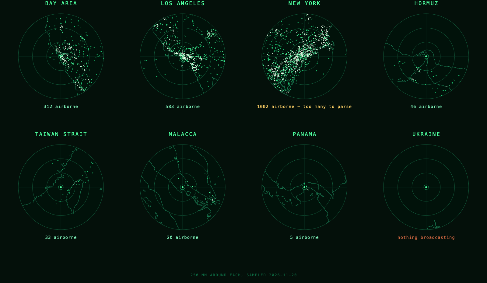
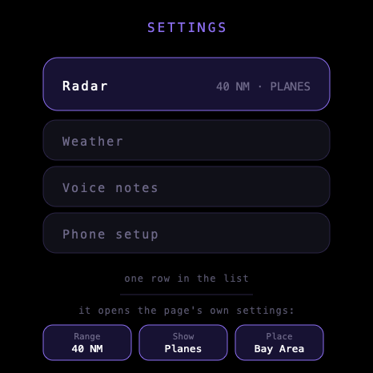

# Radar

**Status:** mockup only
**Branch:** `feat/radar`
**Last updated:** 2026-11-20

## Goal

A swipe page that shows what is moving around a place you care about, drawn as
a radar scope over a coastline: aircraft overhead, ships in a strait, or where
the rain is. One setting picks the range, one picks what to show, one picks the
place, and the range setting's last position is **Off**, which takes the page
out of the swipe list entirely.

## Mockup

Planes, 40 nm around the Bay Area. Every blip is an aircraft that was really in
the air at 12:28 on 2026-11-20, placed where the API said it was; the coastline
is Natural Earth 50m, clipped and projected the same way the firmware would:

### Green, and a map behind it

Yes to both. Green is the right call and the map is nearly free — the coastline
around a place costs **660–2,400 bytes** as int16 pairs, so every place in the
list together is about 15 KB of flash with no tile server, no projection
library and nothing to download at runtime. At this scale plain
equirectangular is accurate enough; the error over a 250 nm radius is smaller
than a blip.

It does mean the page does not match the violet the rest of the firmware uses.
That is the right trade: this page is pretending to be an instrument, and the
coastline needs a colour the blips can sit on top of without competing. Here is
what it looked like in violet without the map, for comparison — flatter, and
without the coast there is nothing to tell you *where* you are looking:

## What to show

### Planes — ready to build

Covered below in Findings: keyless, and the API returns range and bearing
already computed.

### Ships — possible, with two catches

*Illustrative: the hulls above are drawn on plausible lane positions, not live
AIS. Everything else on this page comes from real data.*

AIS is a different kind of feed from the plane one. `aisstream.io` is free, but:

1. **It needs an API key** (sign in with GitHub) — a second token to store on
   the device, like the SDK token already is.
2. **It is a WebSocket stream, not a poll.** You connect to
   `wss://stream.aisstream.io/v0/stream`, send a `BoundingBoxes` subscription
   within 3 seconds, and then read continuously or the service drops your
   messages.

The catch that matters: since September 2026 uncompressed connections are
subject to per-user bandwidth limits, so the stream wants `permessage-deflate`.
**ESP-IDF has no permessage-deflate** — `esp_websocket_client` is a managed
component rather than part of the tree, and grepping the local v6.0.1
components for it returns nothing. So ships are not "the same page with
different blips"; they are a websocket client plus a deflate negotiation.

AISHub is not an option at all: it gives API keys only to people who feed it
their own receiver's data.

### Weather — the cheapest of the three

Not rain-radar imagery — that means raster tiles, projection and compositing,
and RainViewer's terms are personal-use-only anyway. Instead: **sample a polar
grid from Open-Meteo**, which this firmware already talks to for the weather
page. It accepts a list of coordinates in one request, so 24 points (8 bearings
x 3 rings) come back as one 9 KB response in 190 ms with no key, and each wedge
is coloured by its own `precipitation`.

The image above is real: 6 of those 24 cells had rain at Malacca when it was
sampled. 24 cells is coarse — it tells you rain is to the southeast, not where
the edge of the squall is — but it is one request against a 10,000/day budget
rather than 500.

## Where to point it

All eight of the suggested places, 250 nm each, sampled the same afternoon:

This settles the list, and the answer is that **place and mode are coupled**:

| Place | Airborne | Verdict |
|---|---|---|
| New York | 1,199 | Too many — 615 KB per refresh |
| Los Angeles | 755 | Very busy, 375 KB |
| Bay Area | 449 | Busy, 217 KB |
| Hormuz | 62 | Thin for planes, interesting for ships |
| Taiwan Strait | 34 | Thin for planes, the point is the shipping |
| Malacca | 20 | Likewise |
| Panama Canal | 5 | Planes: nothing. Ships: the whole point |
| **Ukraine** | **0** | **Nothing at all** |

Two of these are worth knowing before building anything:

- **Ukraine returns zero aircraft.** Civil airspace is closed and military
  traffic does not broadcast ADS-B. The page would be an empty green circle.
  There is no fix on our side — it is what the data is. Worth keeping on the
  list only once ships are in, and even then AIS in the Black Sea is patchy and
  routinely spoofed.
- **New York at 250 nm returns 1,199 aircraft in a 615 KB body.** The weather
  page's whole body cap is 8 KB. Holding 615 KB is fine in PSRAM; what is not
  obviously fine is cJSON, which builds a DOM several times the size of the
  text. This needs measuring on the board before 250 nm ships, and the likely
  answer is a cap on how many aircraft are kept, taking the nearest N.

So the place list should be the straits and canals *and* the metros, with the
understanding that picking Panama in Planes mode shows you almost nothing. The
page should say "5 aircraft" rather than look broken.

## Config

One row in the main settings list, as before — it opens the page's own
settings, which is where the three choices live:

- **Range** — `12 NM` / `40 NM` / `250 NM` / `Off`. Off is a real off:
  `muse_page_t.enabled()` is checked before the tile is built, so the page
  leaves the swipe list and its task never starts. No page, no polling.
- **Show** — `Planes` / `Ships` / `Weather`.
- **Place** — the table above.

## Plan

1. New component `muse_radar`, modelled on `muse_clock` — own NVS namespace,
   own `MUSE_PAGE`, own settings sub-page. No edits to files upstream touches.
2. A place table of `{name, lat, lon, coastline}` generated at build time from
   Natural Earth by a script in `tools/`, so adding a place is a one-line edit
   and a rebuild.
3. Planes first: `esp_http_client` + `cJSON`, the `muse_weather.c` shape, with
   a cap on aircraft kept.
4. Draw: coastline, rings, blips, the nearest one ringed with a card below.
5. Weather second — same fetch code, different URL, 24 points, wedges.
6. Ships last, and only if the websocket question answers well.

## Findings

- **adsb.lol serves planes keyless over HTTPS.**
  `GET https://api.adsb.lol/v2/point/{lat}/{lon}/{radius_nm}`, 200, no key —
  *(how: curl, 2026-11-20, samples kept for 8 places)*
- **The API does the trigonometry.** Each aircraft carries `dst` (nm from the
  query point) and `dir` (bearing), so a blip is `r = dst/range * R`,
  `θ = dir` — no projection for the blips at all. The coastline *does* need
  projecting, but only once, at build time — *(how: read the fields; checked
  `dir` against an aircraft known to be southwest of Taipei, 242.7°)*
- **500 requests per IP per day**, from `x-ratelimit-limit: 500, 500;w=86400`
  on the live response. Hence polling only while the page is visible —
  *(how: response headers)*
- **Open-Meteo takes 24 coordinates in one request.** 9 KB, 190 ms, no key, and
  it returns a list in the order asked — *(how: curl with 24 comma-separated
  lat/lon pairs; 6 of 24 cells wet at Malacca)*
- **Coastlines are nearly free.** Natural Earth 50m clipped to 250 nm:
  Bay Area 165 points, Hormuz 200, Taiwan Strait 283, Panama 323, Malacca 532,
  New York 601 — 660 to 2,404 bytes each as int16 pairs — *(how: clipped the
  1.6 MB GeoJSON locally and counted)*
- **`alt_baro` is an int *or* the string `"ground"`.** 98 of 192 aircraft
  within 60 nm of San Jose were parked — *(how: counted in the sample)*
- **New York at 250 nm is 1,199 aircraft / 615 KB; Ukraine is 0 / 101 bytes** —
  *(how: the eight-place sample above)*
- **ESP-IDF has no permessage-deflate.** Nothing in the v6.0.1 component tree
  matches it, and `esp_websocket_client` is not in the tree at all — *(how:
  grepped `~/esp/esp-idf-v6.0.1/components`)*
- **Two page slots are free.** `MUSE_PAGES_MAX` is 4; only `clock` and `radio`
  register — *(how: `git grep MUSE_PAGE(`)*

## Blockers

- Nothing blocks planes or weather.
- Ships are blocked on the websocket + deflate question above.

## Open questions

- **Does cJSON survive a 615 KB body on this board?** Needs measuring, not
  reasoning. Until then 250 NM should cap the aircraft it keeps.
- **Supplier risk on the plane feed.** `github.com/adsblol/api` was archived by
  its owner on **2026-11-19** and warns a key will eventually be needed;
  airplanes.live has already closed its public API; `api.adsb.one` returned
  403. `opendata.adsb.fi` answered fine with the same field names and is the
  fallback — *(how: curl, all four, 2026-11-20)*. Keep the source behind one
  function.
- Which place is the default? Bay Area in Planes mode is the one that looks
  alive out of the box.

## References

- Files to add: `esp32/components/muse_radar/`
- Patterned on: `esp32/components/muse_clock/muse_clock.c`,
  `esp32/components/muse_clock/muse_weather.c`
- Page contract: `esp32/components/muse/muse_page.h`
- Data: [adsb.lol](https://api.adsb.lol/v2/point/), [adsb.fi](https://opendata.adsb.fi/),
  [aisstream.io](https://aisstream.io/documentation),
  [Open-Meteo](https://api.open-meteo.com/v1/forecast),
  [Natural Earth coastline](https://github.com/nvkelso/natural-earth-vector)
- Prior art: [Alex-developer/ADSB-Radar](https://github.com/Alex-developer/ADSB-Radar)
  (ESP32-P4, same idea, worth reading for the altitude colouring)
