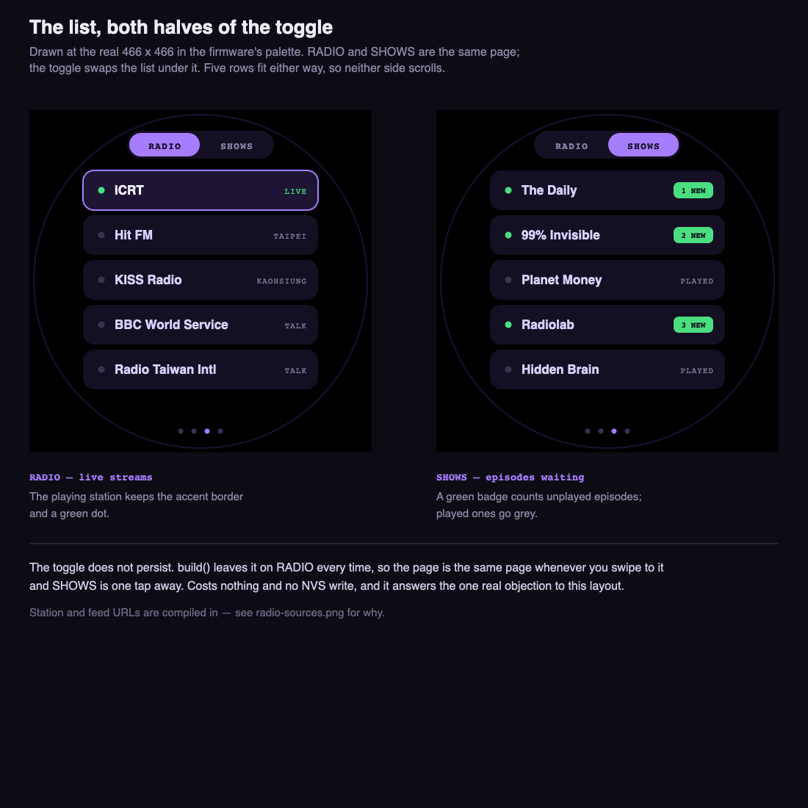
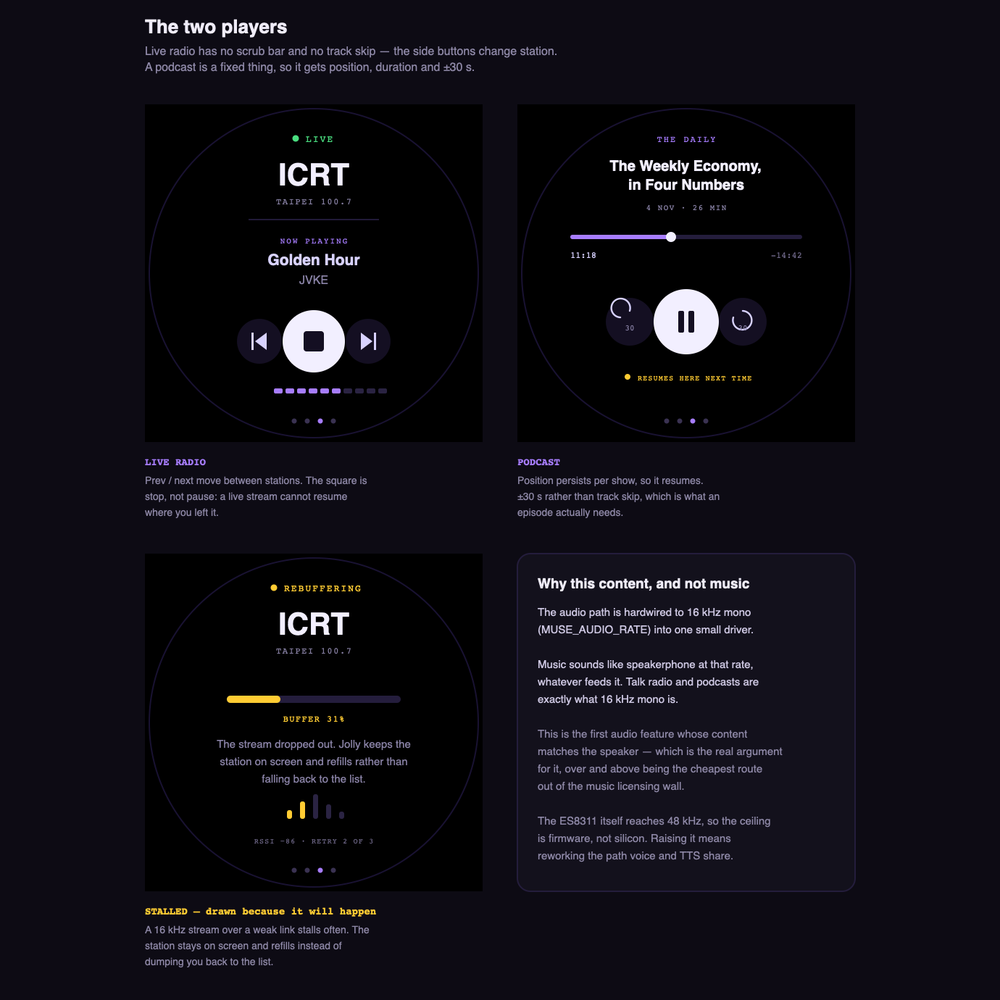
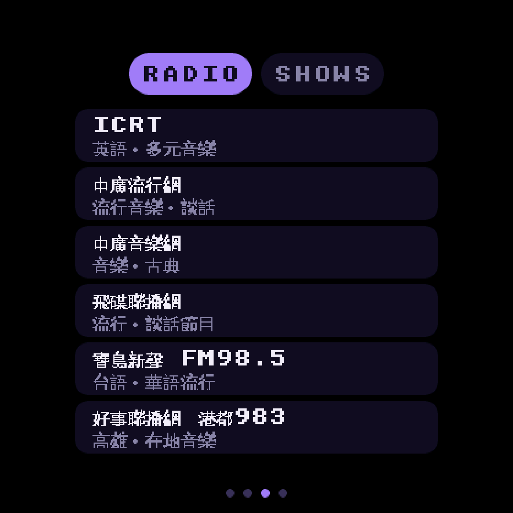
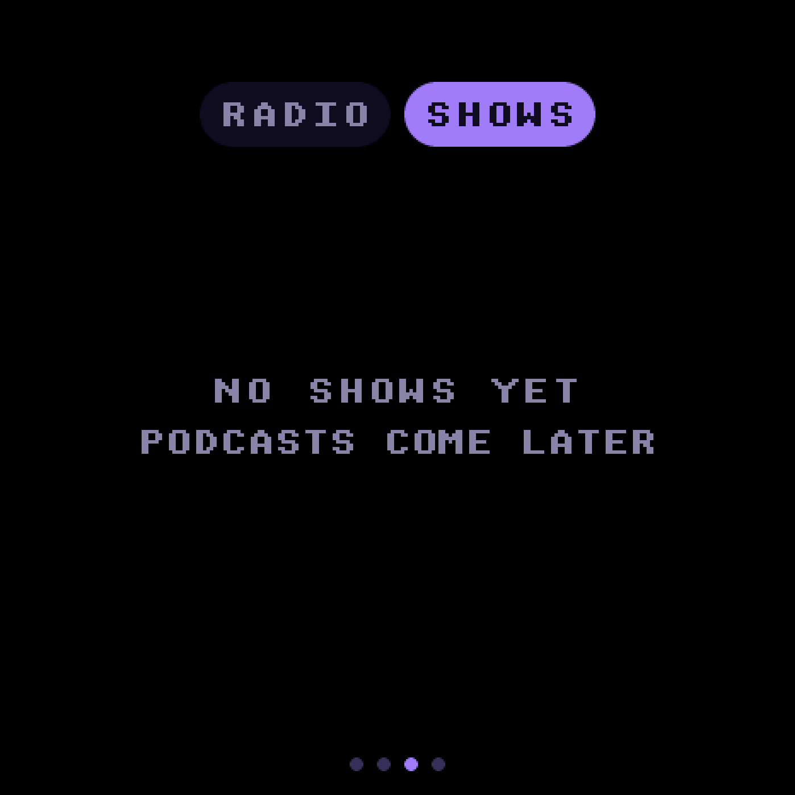
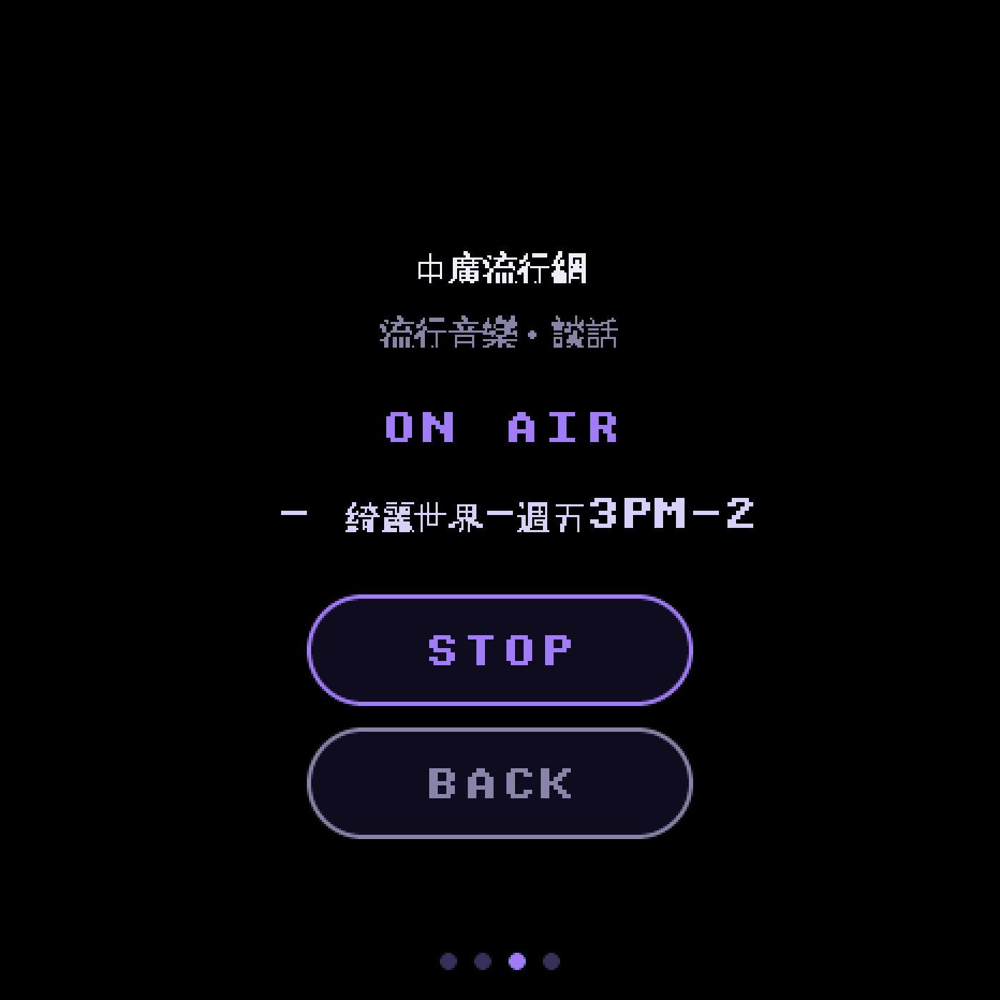
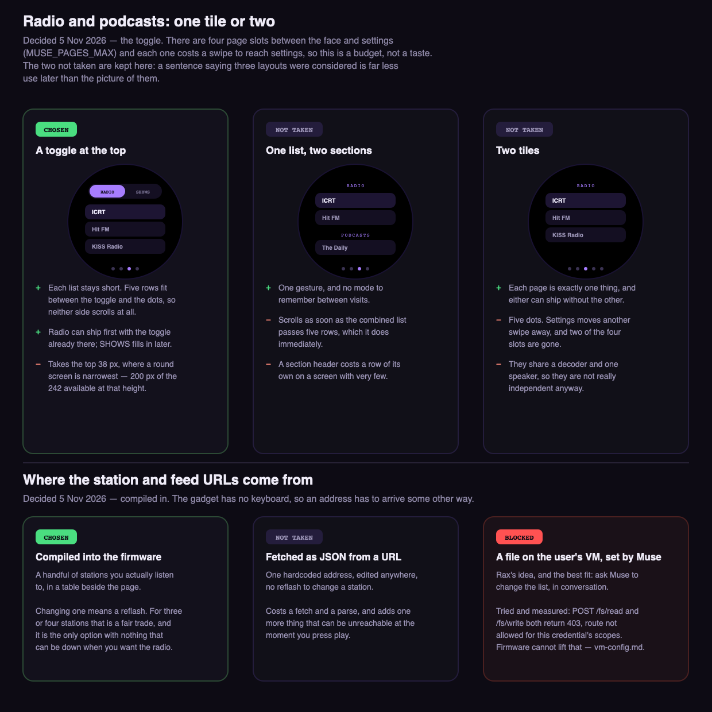

# Internet radio and podcasts

**Status:** radio implemented (MP3, AAC and HLS), podcasts not started
**Branch:** `docs/radio-plan`
**Last updated:** 2026-11-06

## Goal

A third page: internet radio and podcasts, both on one tile. This is
**route 2** of the four in [music.md](music.md), and picking it answers the
licensing question that blocked music — plain MP3 over HTTPS, no account, no
service to get permission from.

## What it looks like

Drawn at the real 466 x 466 in the firmware's palette, so these sit beside a
photo of the panel. These are the mockups the decisions below were taken
from; the shipped page follows them, with the differences noted under
*What was built*.

And this is the page on the board, captured over the USB cable from a bench
build on 2026-11-05 — the station list, the SHOWS half of the toggle, and the
player with a live ICY title on it:

## Decisions

Taken 2026-11-05, from the mockup
(<https://claude.ai/artifact/9iSrMEuRm4vByKvzvWne5W>).

- **A toggle at the top, not one list and not two tiles.** RADIO and SHOWS
  swap the list under them. Five rows fit between the toggle and the page
  dots, so neither side scrolls — a combined list would scroll immediately.
  Two tiles would cost five dots and two of the four page slots.
- **The toggle does not persist.** `build()` leaves it on RADIO every time,
  so the page is the same page whenever you swipe to it and SHOWS is one tap
  away. Costs nothing and no NVS write, and it answers the one real objection
  to the layout — coming back to a page you left on the other half.
- **The station and feed URLs are compiled in.** A table beside the page.
  Changing one means a reflash, which for three or four stations is a fair
  trade, and it is the only option with nothing that can be unreachable at
  the moment you press play.
- **Live radio gets no scrub bar and no track skip.** The side buttons change
  *station*; the middle one is stop rather than pause, because a live stream
  cannot resume where you left it. A podcast is a fixed thing, so it gets
  position, duration, ±30 s and a resume point.

## What was built

`esp32/components/muse_radio/`, a component of its own like `muse_clock`,
registered with `MUSE_PAGE` and `WHOLE_ARCHIVE`. Off with
`CONFIG_MUSE_RADIO_ENABLED=n`, which drops the tile rather than hiding it.

| File | What it is |
|---|---|
| `muse_radio.c` | the stream: fetch, redirects, HLS, ICY and TS demux, MP3/AAC decode, resample, speaker |
| `muse_radio_page.c` | the tile: toggle, list, player |

**The type is sized by the CJK font.** Station names are Chinese now, and the
board's CJK fallback (`CONFIG_MUSE_CJK_FONT`, Unifont) is a 16 px cell — so
16 px is both the floor and the ceiling for anything that might not be ASCII.
The page was built at `unscii_8`, which is why it read as too small; it is
now 16 px throughout, which also forced the rows from 52 px to 64 px and the
list from five rows to four. `muse_page_caption_font()` was added to
`muse_page.h` so a page can reach the fallback font the UI already builds.

**STOP and BACK broke the scroll chain.** The tile is a tileview, which
scrolls. A press that drifts past the indev's scroll limit hands the gesture
to the tileview; the button gets `PRESS_LOST` and `LV_EVENT_CLICKED` never
arrives — which is exactly "sometimes not working when clicked". Clearing
`LV_OBJ_FLAG_SCROLL_CHAIN` on the buttons and the toggle pills keeps the
press on the button. The cost is that a swipe *started on* one of them no
longer turns the page.

**Radio only.** SHOWS is the empty state the toggle was chosen to make
possible — "NO SHOWS YET / PODCASTS COME AFTER RADIO". Nothing moves when the
RSS half arrives.

**Two tasks, both with PSRAM stacks, and a 48 KB ring between them.** The
fetch task strips ICY metadata and pushes MP3 bytes; the decode task pulls,
decodes, resamples and writes. `muse_audio_write()` is blocking, so the
speaker paces the whole chain and nothing needs a timer. 20 KB prebuffer
before the first sample, 12 KB to recover from a stall. The split is what
absorbs network jitter — one task doing both would stall audio on every slow
read.

**The decode path is the TTS one.** Same `MP3_HOLD` hold-back so minimp3 can
see the next frame header, same stereo-to-mono mix, same linear resampler to
16 kHz. The resampler is now in the tree **three times**
(`muse_chat_session.cpp`, `muse_voice_call_core.c`, here); it is twenty lines
and the other two are `static` in files this cannot include, so it was copied
rather than refactored. Worth unifying, not worth blocking this on.

**ICY headers have to be caught as they arrive.** `esp_http_client` keeps
only the response headers it needs itself, so asking it for `icy-metaint`
after `fetch_headers()` comes back empty — the first build on the board
logged `metaint 0` for stations `curl` plainly shows sending `icy-metaint:
16000`. An `HTTP_EVENT_ON_HEADER` handler fixes it, and the now-playing line
then follows the stream: *Wes Parker — Dinosaur Park*, then *Morphine — Swing
It Low* when the track changed — *(how: the capture below, 2026-11-05)*.

**AAC, because Taiwan streams AAC.** Four of the five stations Rax asked for
are AAC on Triton/revma, so the page carries a second decoder:
`espressif/esp_audio_codec` (~2.6), opened with `aac_plus_enable` because
these are HE-AAC rather than plain LC. The format is chosen from the final
response's `Content-Type`, and the two decoders share everything after the
frame: mono mix, resampler, speaker. AAC frames decode to 2048 samples a
channel against MP3's 1152, so the PCM buffer is sized for the larger and the
hold-back is per format.

It is a prebuilt binary component under Espressif's own licence, not Apache
like the rest of the tree. That was Rax's call, taken 2026-11-05 once the
measurement showed the alternative was four stations that could not play.

**Redirects are followed by hand.** Triton answers the published URL with a
302 to a short-lived token URL on the nearest node, dropping from https to
http on the way. `disable_auto_redirect` stays on and the loop re-opens on
`Location` itself, up to four hops, so the headers that pick the decoder are
the *final* response's rather than the redirect's.

**HLS, for the last station.** 好事聯播網 publishes a playlist of MPEG-TS
segments rather than a stream, so there are two more layers: the playlist is
walked for segments it has not played, and each segment is demuxed — PAT for
the PMT's pid, PMT for the audio pid and its codec, then PES payloads on that
pid pushed on while the H.264 video riding alongside is dropped. What comes
out is the same ADTS AAC the Triton stations send directly, so the decoder
below it did not change.

**The ring's backpressure is what keeps HLS at the live edge.** A segment is
475 KB of which only ~60 KB is audio; `push()` blocks while the decoder is
behind, so a segment downloads at roughly the speed the speaker drains it.
Nothing schedules this. On joining, it starts one segment back from the end
so the first is certainly complete, and after a stall it rejoins at the edge
rather than trying to catch up through segments the station has dropped.

Not implemented, and each would be a silent wrong answer rather than a crash,
so the demuxer logs instead of guessing: `#EXT-X-KEY` encryption, byte ranges,
and PAT/PMT sections split across packets. None appears in this stream.

**The page refuses what it cannot play.** Non-200 and any Content-Type
without `mpeg`/`mp3` in it stop with a reason on screen rather than silence,
because there is no AAC or Ogg decoder on the board.

**Muse wins the speaker.** `tick()` runs ~1 Hz whichever page is visible; if
the mode is listening, thinking or speaking, the radio stops. Stop, not
pause: a live stream cannot resume where it left off. The cost is up to a
second of both at once at the start of a talk press.

## Findings

- **The speaker picks the content.** The audio path is hardwired to 16 kHz
  mono (`MUSE_AUDIO_RATE`) into one small driver, so music sounds like
  speakerphone whatever feeds it — but talk radio and podcasts are exactly
  what 16 kHz mono is. This is the first audio feature whose content matches
  the speaker, which is a better argument for it than being the cheapest
  route — *(how: `muse_audio.h` and the board file, recorded in music.md)*.
- **Settings on the user's VM were tried first, and are blocked.** Rax's idea
  was to ask Muse to change the station list in conversation, which is the
  best fit of the three and the one the SDK is shaped for. The firmware was
  written and run: `POST /fs/read` and `POST /fs/write` both return **403
  `route not allowed for this credential's scopes`**, while `GET
  /chat/history` on the same session returns 200. So the transport works and
  those two routes specifically are refused. [vm-config.md](vm-config.md) has
  the measurement and the code is on `feat/vm-config` — *(how: a bench build
  on the board, over a live session)*.
- **Only three of eight first-pass candidate streams were usable.** Every URL
  was checked with `curl -I -H 'Icy-MetaData: 1'` before any was compiled in:

  | Stream | Code | Content-Type | `icy-metaint` |
  |---|---|---|---|
  | BBC World Service | 200 | **audio/mpeg** | 16000 |
  | Radio Paradise `mp3-128` | 200 | **audio/mpeg** | 16000 |
  | France Inter `midfi` | 200 | **audio/mpeg** | none |
  | Radio Paradise `rock-128` | 200 | audio/aac | 16000 |
  | listen.moe | 200 | audio/ogg | none |
  | SomaFM Groove Salad | 403 | — | — |
  | **ICRT** | **403** | text/html | — |
  | Radio.co (revma) | 302 → 200 | audio/aac | 16000 |

  Two things follow. AAC and Ogg are common and there is no decoder for
  either, so the table is MP3-only and the page checks Content-Type. And ICY
  metadata is real but not universal: France Inter sends none, so the
  now-playing line has to be empty rather than guessed — *(how: `curl` from
  this machine, 2026-11-05)*. The ICRT line here is superseded by the
  finding below: that was the wrong URL.
- **Four of the five Taiwanese stations Rax asked for are AAC — now they
  play.** Asked on 2026-11-05 for ICRT, 中廣, 飛碟, 好事 and 寶島新聲 as the
  defaults. Every one was looked up in the
  [radio-browser](https://www.radio-browser.info/) directory and then probed
  directly:

  | Station | Code | Format | Usable today |
  |---|---|---|---|
  | 寶島新聲 FM98.5 | 200 | **audio/mpeg**, 64 kbps | **yes** |
  | ICRT | 302 → 200 | audio/aac | no decoder |
  | 中廣流行網 | 302 → 200 | audio/aac | no decoder |
  | 中廣音樂網 | 302 → 200 | audio/aac | no decoder |
  | 飛碟電台 | 302 → 200 | audio/aac | no decoder |
  | 飛碟 南台灣之聲 | 200 | audio/aac | no decoder |
  | 好事聯播網 港都983 | 200 | `application/vnd.apple.mpegurl` | HLS, not a stream |

  The four AAC ones were reachable and healthy all along — 200, with
  `icy-metaint: 16000`. They needed a decoder, not a different URL, and they
  have one now. 好事 is the one left out: HLS is a protocol rather than a
  codec — but it is in too now, over HLS — *(how: `curl -L` with the
  firmware's own user agent, then each one played on the board)*.
- **HLS held for 110 seconds without a rebuffer.** About thirteen segments,
  so segment rollover and playlist re-polling both work, not just the first
  fetch. The state never left `PLAYING` and nothing was logged — *(how: a
  soak on station 5 over the console, 2026-11-06)*.
- **All six in the table play on the board.** Driven one after another from
  the console: ICRT (AAC 48 kHz), 中廣流行網 (AAC 44.1 kHz, with a Chinese
  ICY title on screen), 中廣音樂網 (AAC, `CHRISTOPHER - TULIPS`), 飛碟聯播網
  (AAC 48 kHz), 寶島新聲 (MP3 44.1 kHz) and 好事聯播網 (HLS, AAC 48 kHz on
  pid 257). Every one reached `PLAYING` with an empty error — *(how:
  `page=radio:play=<n>` across the table, 2026-11-06)*.
- **HE-AAC decodes at the station's full rate.** `aac_plus_enable` gives
  48 kHz and 44.1 kHz output rather than the half-rate core, which the
  resampler then takes down to 16 kHz. Worth knowing because the cheaper
  option — ignoring SBR — would also have "worked", just dully.
- **The earlier "ICRT can't be reached from this network" was wrong.** It was
  measured against `live.leanstream.co`, which 403s for everyone. ICRT's
  Triton/revma stream answers 200 from here. What rules ICRT out is the
  codec, not the network.
- **Rebuffering is not an edge case.** A 16 kHz stream over a weak link
  stalls; this board logged `rssi -86` and three join attempts on an ordinary
  evening. The stalled state is drawn because it will be seen often: the
  station stays on screen and refills rather than dropping back to the list.
- **Two of the three stations send ICY metadata; France Inter sends none.**
  Confirmed on the board, not only by `curl`. So the now-playing line is real
  and worth having, and it is also genuinely empty a third of the time —
  which is why it is a line that can be blank rather than a field with a
  placeholder in it.
- **BBC serves the board a 24 kHz, 56 kbps variant.** `curl` on the laptop
  and the gadget get different encodings from the same URL. It decodes fine,
  but it is a reminder that the stream a station hands you is not fixed —
  the resampler earns its place — *(how: `radio: stream: 24000 Hz, 2 ch, 56
  kbps` in the boot log)*.
- **Podcasts cost much more than radio.** Radio is a URL. A podcast is an RSS
  feed to parse (XML on an ESP32), an episode list to hold, and a resume
  position per show in NVS. Same tile, but not the same size of job.

## Open questions

- **Six rows is the hard limit.** At 16 px type and 48 px rows the list holds
  six, and that is the round panel's edge. A seventh station needs either
  scrolling — which the toggle decision was taken to avoid — or a smaller
  CJK font than the board has.
- **HLS carries video the board pays for and throws away.** Most of each
  segment is H.264. It costs download, not CPU, but on a metered link it
  would matter. An audio-only variant would be the fix if the station
  published one.
- **The 1 Hz handover to Muse.** A talk press and the radio overlap for up to
  a second. Cheap to fix properly by hooking the press rather than polling the
  mode, if it grates in use.
- **Where does the page sit in the tile order?** Registration order, so after
  the clock today — four dots.
- **Nothing rests the codecs while the radio plays.** `muse_voice.c` powers
  the codecs down when Muse sleeps on battery with nothing to do, and it does
  not know the radio exists. Whether a stream survives that, or should, is
  untested.
- **Internal RAM is tight.** The heartbeat showed `min=4K` free internal heap.
  PSRAM is fine (2.7 MB free) and the stream buffer belongs there, but
  anything new in internal RAM needs watching.

## References

- [music.md](music.md) — the four routes; this is route 2
- [vm-config.md](vm-config.md) — why the list is compiled in rather than
  edited by Muse
- [voice.md](voice.md) — the MP3 decode path this reuses: HTTPS fetch on a
  worker task, cross-signed cert verification, minimp3, a stream buffer whose
  backpressure is already demonstrated. A radio stream never ends, which is
  the one real difference.
- `esp32/components/muse/muse_page.h` — `MUSE_PAGE`, the tile contract
- `esp32/components/muse_clock/muse_clock.c` — the one registered page today,
  and the pattern to follow
- `esp32/components/muse/muse_audio.h` — `MUSE_AUDIO_RATE`, the 16 kHz ceiling
