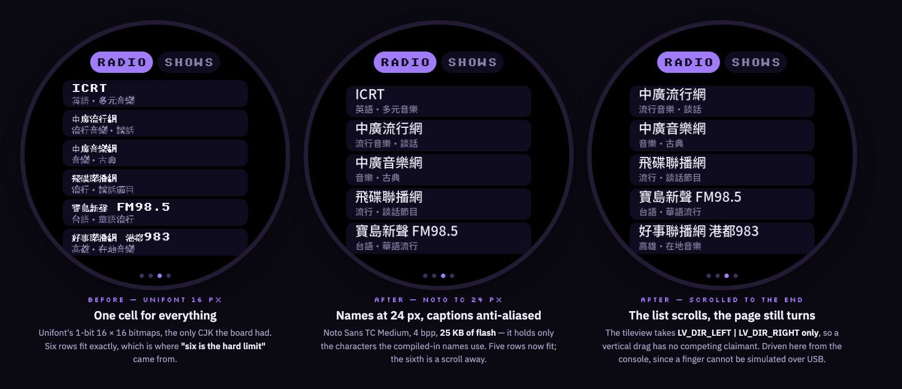
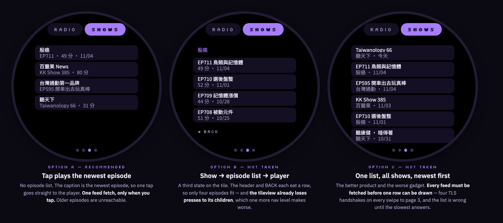
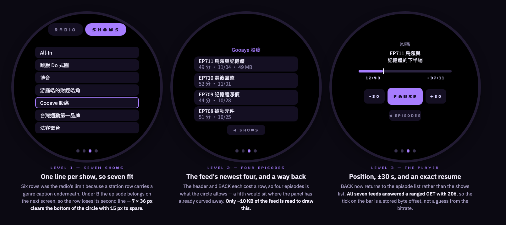
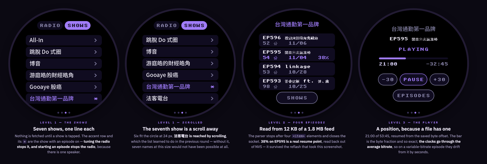

# Internet radio and podcasts

**Status:** radio implemented (MP3, AAC and HLS), now at 24 px in a
scrolling list; podcasts implemented too — option B, seven shows, four
episodes each, with a resume point per show in NVS
**Branch:** `docs/radio-plan`
**Last updated:** 2026-11-06

## Goal

A third page: internet radio and podcasts, both on one tile. This is
**route 2** of the four in [music.md](music.md), and picking it answers the
licensing question that blocked music — plain MP3 over HTTPS, no account, no
service to get permission from.

## What it looks like

Drawn at the real 466 x 466 in the firmware's palette, so these sit beside a
photo of the panel. These are the mockups the decisions below were taken
from; the shipped page follows them, with the differences noted under
*What was built*.

And this is the page on the board, captured over the USB cable from a bench
build on 2026-11-05 — the station list, the SHOWS half of the toggle, and the
player with a live ICY title on it:

That empty SHOWS half is now filled; the three screens behind it are under
[Podcasts: the SHOWS half](#podcasts-the-shows-half).

## Decisions

Taken 2026-11-05, from the mockup
(<https://claude.ai/artifact/9iSrMEuRm4vByKvzvWne5W>).

- **A toggle at the top, not one list and not two tiles.** RADIO and SHOWS
  swap the list under them. Five rows fit between the toggle and the page
  dots, so neither side scrolls — a combined list would scroll immediately.
  Two tiles would cost five dots and two of the four page slots.
- **The toggle does not persist.** `build()` leaves it on RADIO every time,
  so the page is the same page whenever you swipe to it and SHOWS is one tap
  away. Costs nothing and no NVS write, and it answers the one real objection
  to the layout — coming back to a page you left on the other half.
- **The station and feed URLs are compiled in.** A table beside the page.
  Changing one means a reflash, which for three or four stations is a fair
  trade, and it is the only option with nothing that can be unreachable at
  the moment you press play.
- **Live radio gets no scrub bar and no track skip.** The side buttons change
  *station*; the middle one is stop rather than pause, because a live stream
  cannot resume where you left it. A podcast is a fixed thing, so it gets
  position, duration, ±30 s and a resume point.

## What was built

`esp32/components/muse_radio/`, a component of its own like `muse_clock`,
registered with `MUSE_PAGE` and `WHOLE_ARCHIVE`. Off with
`CONFIG_MUSE_RADIO_ENABLED=n`, which drops the tile rather than hiding it.

| File | What it is |
|---|---|
| `muse_radio.c` | the stream: fetch, redirects, HLS, ICY and TS demux, MP3/AAC decode, resample, speaker |
| `muse_radio_page.c` | the tile: toggle, list, player |

**The type is sized by the CJK font.** Station names are Chinese now, and the
board's CJK fallback (`CONFIG_MUSE_CJK_FONT`, Unifont) is a 16 px cell — so
16 px is both the floor and the ceiling for anything that might not be ASCII.
The page was built at `unscii_8`, which is why it read as too small; it is
now 16 px throughout, which also forced the rows from 52 px to 64 px and the
list from five rows to four. `muse_page_caption_font()` was added to
`muse_page.h` so a page can reach the fallback font the UI already builds.

**STOP and BACK broke the scroll chain.** The tile is a tileview, which
scrolls. A press that drifts past the indev's scroll limit hands the gesture
to the tileview; the button gets `PRESS_LOST` and `LV_EVENT_CLICKED` never
arrives — which is exactly "sometimes not working when clicked". Clearing
`LV_OBJ_FLAG_SCROLL_CHAIN` on the buttons and the toggle pills keeps the
press on the button. The cost is that a swipe *started on* one of them no
longer turns the page.

**Radio only.** SHOWS is the empty state the toggle was chosen to make
possible — "NO SHOWS YET / PODCASTS COME AFTER RADIO". Nothing moves when the
RSS half arrives.

**Two tasks, both with PSRAM stacks, and a 48 KB ring between them.** The
fetch task strips ICY metadata and pushes MP3 bytes; the decode task pulls,
decodes, resamples and writes. `muse_audio_write()` is blocking, so the
speaker paces the whole chain and nothing needs a timer. 20 KB prebuffer
before the first sample, 12 KB to recover from a stall. The split is what
absorbs network jitter — one task doing both would stall audio on every slow
read.

**The decode path is the TTS one.** Same `MP3_HOLD` hold-back so minimp3 can
see the next frame header, same stereo-to-mono mix, same linear resampler to
16 kHz. The resampler is now in the tree **three times**
(`muse_chat_session.cpp`, `muse_voice_call_core.c`, here); it is twenty lines
and the other two are `static` in files this cannot include, so it was copied
rather than refactored. Worth unifying, not worth blocking this on.

**ICY headers have to be caught as they arrive.** `esp_http_client` keeps
only the response headers it needs itself, so asking it for `icy-metaint`
after `fetch_headers()` comes back empty — the first build on the board
logged `metaint 0` for stations `curl` plainly shows sending `icy-metaint:
16000`. An `HTTP_EVENT_ON_HEADER` handler fixes it, and the now-playing line
then follows the stream: *Wes Parker — Dinosaur Park*, then *Morphine — Swing
It Low* when the track changed — *(how: the capture below, 2026-11-05)*.

**AAC, because Taiwan streams AAC.** Four of the five stations Rax asked for
are AAC on Triton/revma, so the page carries a second decoder:
`espressif/esp_audio_codec` (~2.6), opened with `aac_plus_enable` because
these are HE-AAC rather than plain LC. The format is chosen from the final
response's `Content-Type`, and the two decoders share everything after the
frame: mono mix, resampler, speaker. AAC frames decode to 2048 samples a
channel against MP3's 1152, so the PCM buffer is sized for the larger and the
hold-back is per format.

It is a prebuilt binary component under Espressif's own licence, not Apache
like the rest of the tree. That was Rax's call, taken 2026-11-05 once the
measurement showed the alternative was four stations that could not play.

**Redirects are followed by hand.** Triton answers the published URL with a
302 to a short-lived token URL on the nearest node, dropping from https to
http on the way. `disable_auto_redirect` stays on and the loop re-opens on
`Location` itself, up to four hops, so the headers that pick the decoder are
the *final* response's rather than the redirect's.

**HLS, for the last station.** 好事聯播網 publishes a playlist of MPEG-TS
segments rather than a stream, so there are two more layers: the playlist is
walked for segments it has not played, and each segment is demuxed — PAT for
the PMT's pid, PMT for the audio pid and its codec, then PES payloads on that
pid pushed on while the H.264 video riding alongside is dropped. What comes
out is the same ADTS AAC the Triton stations send directly, so the decoder
below it did not change.

**The ring's backpressure is what keeps HLS at the live edge.** A segment is
475 KB of which only ~60 KB is audio; `push()` blocks while the decoder is
behind, so a segment downloads at roughly the speed the speaker drains it.
Nothing schedules this. On joining, it starts one segment back from the end
so the first is certainly complete, and after a stall it rejoins at the edge
rather than trying to catch up through segments the station has dropped.

Not implemented, and each would be a silent wrong answer rather than a crash,
so the demuxer logs instead of guessing: `#EXT-X-KEY` encryption, byte ranges,
and PAT/PMT sections split across packets. None appears in this stream.

**The page refuses what it cannot play.** Non-200 and any Content-Type
without `mpeg`/`mp3` in it stop with a reason on screen rather than silence,
because there is no AAC or Ogg decoder on the board.

**Muse wins the speaker.** `tick()` runs ~1 Hz whichever page is visible; if
the mode is listening, thinking or speaking, the radio stops. Stop, not
pause: a live stream cannot resume where it left off. The cost is up to a
second of both at once at the start of a talk press.

## Findings

- **The speaker picks the content.** The audio path is hardwired to 16 kHz
  mono (`MUSE_AUDIO_RATE`) into one small driver, so music sounds like
  speakerphone whatever feeds it — but talk radio and podcasts are exactly
  what 16 kHz mono is. This is the first audio feature whose content matches
  the speaker, which is a better argument for it than being the cheapest
  route — *(how: `muse_audio.h` and the board file, recorded in music.md)*.
- **Settings on the user's VM were tried first, and are blocked.** Rax's idea
  was to ask Muse to change the station list in conversation, which is the
  best fit of the three and the one the SDK is shaped for. The firmware was
  written and run: `POST /fs/read` and `POST /fs/write` both return **403
  `route not allowed for this credential's scopes`**, while `GET
  /chat/history` on the same session returns 200. So the transport works and
  those two routes specifically are refused. [vm-config.md](vm-config.md) has
  the measurement and the code is on `feat/vm-config` — *(how: a bench build
  on the board, over a live session)*.
- **Only three of eight first-pass candidate streams were usable.** Every URL
  was checked with `curl -I -H 'Icy-MetaData: 1'` before any was compiled in:

  | Stream | Code | Content-Type | `icy-metaint` |
  |---|---|---|---|
  | BBC World Service | 200 | **audio/mpeg** | 16000 |
  | Radio Paradise `mp3-128` | 200 | **audio/mpeg** | 16000 |
  | France Inter `midfi` | 200 | **audio/mpeg** | none |
  | Radio Paradise `rock-128` | 200 | audio/aac | 16000 |
  | listen.moe | 200 | audio/ogg | none |
  | SomaFM Groove Salad | 403 | — | — |
  | **ICRT** | **403** | text/html | — |
  | Radio.co (revma) | 302 → 200 | audio/aac | 16000 |

  Two things follow. AAC and Ogg are common and there is no decoder for
  either, so the table is MP3-only and the page checks Content-Type. And ICY
  metadata is real but not universal: France Inter sends none, so the
  now-playing line has to be empty rather than guessed — *(how: `curl` from
  this machine, 2026-11-05)*. The ICRT line here is superseded by the
  finding below: that was the wrong URL.
- **Four of the five Taiwanese stations Rax asked for are AAC — now they
  play.** Asked on 2026-11-05 for ICRT, 中廣, 飛碟, 好事 and 寶島新聲 as the
  defaults. Every one was looked up in the
  [radio-browser](https://www.radio-browser.info/) directory and then probed
  directly:

  | Station | Code | Format | Usable today |
  |---|---|---|---|
  | 寶島新聲 FM98.5 | 200 | **audio/mpeg**, 64 kbps | **yes** |
  | ICRT | 302 → 200 | audio/aac | no decoder |
  | 中廣流行網 | 302 → 200 | audio/aac | no decoder |
  | 中廣音樂網 | 302 → 200 | audio/aac | no decoder |
  | 飛碟電台 | 302 → 200 | audio/aac | no decoder |
  | 飛碟 南台灣之聲 | 200 | audio/aac | no decoder |
  | 好事聯播網 港都983 | 200 | `application/vnd.apple.mpegurl` | HLS, not a stream |

  The four AAC ones were reachable and healthy all along — 200, with
  `icy-metaint: 16000`. They needed a decoder, not a different URL, and they
  have one now. 好事 is the one left out: HLS is a protocol rather than a
  codec — but it is in too now, over HLS — *(how: `curl -L` with the
  firmware's own user agent, then each one played on the board)*.
- **HLS held for 110 seconds without a rebuffer.** About thirteen segments,
  so segment rollover and playlist re-polling both work, not just the first
  fetch. The state never left `PLAYING` and nothing was logged — *(how: a
  soak on station 5 over the console, 2026-11-06)*.
- **All six in the table play on the board.** Driven one after another from
  the console: ICRT (AAC 48 kHz), 中廣流行網 (AAC 44.1 kHz, with a Chinese
  ICY title on screen), 中廣音樂網 (AAC, `CHRISTOPHER - TULIPS`), 飛碟聯播網
  (AAC 48 kHz), 寶島新聲 (MP3 44.1 kHz) and 好事聯播網 (HLS, AAC 48 kHz on
  pid 257). Every one reached `PLAYING` with an empty error — *(how:
  `page=radio:play=<n>` across the table, 2026-11-06)*.
- **HE-AAC decodes at the station's full rate.** `aac_plus_enable` gives
  48 kHz and 44.1 kHz output rather than the half-rate core, which the
  resampler then takes down to 16 kHz. Worth knowing because the cheaper
  option — ignoring SBR — would also have "worked", just dully.
- **The earlier "ICRT can't be reached from this network" was wrong.** It was
  measured against `live.leanstream.co`, which 403s for everyone. ICRT's
  Triton/revma stream answers 200 from here. What rules ICRT out is the
  codec, not the network.
- **Rebuffering is not an edge case.** A 16 kHz stream over a weak link
  stalls; this board logged `rssi -86` and three join attempts on an ordinary
  evening. The stalled state is drawn because it will be seen often: the
  station stays on screen and refills rather than dropping back to the list.
- **Two of the three stations send ICY metadata; France Inter sends none.**
  Confirmed on the board, not only by `curl`. So the now-playing line is real
  and worth having, and it is also genuinely empty a third of the time —
  which is why it is a line that can be blank rather than a field with a
  placeholder in it.
- **BBC serves the board a 24 kHz, 56 kbps variant.** `curl` on the laptop
  and the gadget get different encodings from the same URL. It decodes fine,
  but it is a reminder that the stream a station hands you is not fixed —
  the resampler earns its place — *(how: `radio: stream: 24000 Hz, 2 ch, 56
  kbps` in the boot log)*.
- **Podcasts cost much more than radio.** Radio is a URL. A podcast is an RSS
  feed to parse (XML on an ESP32), an episode list to hold, and a resume
  position per show in NVS. Same tile, but not the same size of job.

## Font size, and whether a list can scroll

**Both built and on the board, 2026-11-06.** Rax asked two questions the same
evening — can a list scroll, and can the type be bigger — and they turn out to
be the same question, because enlarging the type is what makes a list too long
for the circle.

### Scrolling: yes, and it costs nothing

**The tileview only takes horizontal drags.** Every tile is added with
`LV_DIR_LEFT | LV_DIR_RIGHT` (`muse_ui.c`), so a vertical drag has no
competing claimant and the row container can simply be made scrollable. This
is the opposite of the STOP/BACK bug, where a *horizontal* drift was claimed
by the tileview: the axes do not overlap, so page-turning is untouched.

`SCROLL_CHAIN` is cleared on the container anyway, so an over-scroll at either
end stops there rather than becoming a page turn.

**It cannot be verified from here.** A finger cannot be simulated over USB, so
the console grew `>page=radio:scroll=<px>` and the third panel above is the
list driven to its end programmatically. That proves the geometry and the
clipping; it does not prove the gesture.

### Type: yes, up to 24 px, and only for names the firmware owns

The ceiling was never the font pipeline — it is the **4 MB app slot, of which
3.61 MB was already used**. Unifont's CJK alone is 1.2 MB of that.

| Font | Coverage | Flash |
|---|---|---|
| Unifont 16 px (today's fallback) | every CJK ideograph, kana, Hangul | 1.2 MB |
| Noto TC, Big5 level 1, 16 px | 5495 common traditional characters | 0.44 MB |
| Noto TC, Big5 level 1, 24 px | same | 0.86 MB |
| **Noto TC, the names only, 16 + 24 px** | **the 78 characters the tables use** | **25 KB** |

*(how: `lv_font_conv@1.5.3` against NotoSansTC-Medium, bytes counted in the
generated C.)*

**So the subset is what shipped.** `CONFIG_MUSE_PAGE_CJK_24` adds 25 KB and
gives `muse_page_list_font()` (24 px) and `muse_page_list_sub_font()` (16 px,
anti-aliased to match). Both fall back to the caption font, so nothing
disappears — it is drawn small instead.

- **This works only for text the firmware owns.** Station names and genres are
  a compiled-in table, so their characters are known at build time. An episode
  title or an ICY now-playing line arrives from the network and will fall back
  to 16 px Unifont. Podcasts under option B put a runtime title on screen at
  level 2, so that line cannot be enlarged this way.
- **Adding a station now means regenerating the font.** A missing character
  does not fail the build; it draws small beside its 24 px neighbours.
  `tools/muse/gen_page_cjk_font.sh` carries the character list.
- **The existing Noto option is useless here.** `CONFIG_MUSE_CJK_FONT_NOTO` is
  Noto Sans **SC** over GB2312 — simplified only, so 廣, 聲, 樂, 灣 and 電 are
  all missing. Every one of them is in a station name. Unifont is the only
  full fallback this board has.
- **The row grew from 48 px to 56 px**, so five of the six stations are on
  screen and the sixth is a scroll away. Six no longer fit, and that is the
  point: the limit moved from the panel to the scroll.

### What would make runtime text bigger

Replacing Unifont with Noto TC Big5 level 1 at 24 px is **0.86 MB against
1.2 MB — it saves 340 KB** and makes every CJK glyph on the gadget bigger and
anti-aliased, captions and chat replies included. The cost is coverage: no
Hangul, no kana, and no rare or simplified-only character, each of which
becomes a box in a Muse reply. Not taken tonight, because it changes what chat
can draw and that is a decision about the whole gadget rather than this page.

## Podcasts: the SHOWS half

**Decided 2026-11-06, and built the same day** — see "Built" below for what
the board actually does. Mockups:
<https://claude.ai/artifact/XMLK42mbxoMfv4eHtp62Rp>

### The shows

Rax's seven, 2026-11-06. Feed URLs resolved through the iTunes lookup API and
each one fetched, so these are the real published feeds and the table is
measured rather than assumed.

| Show | Feed | Feed XML | Items | Newest |
|---|---|---|---|---|
| All-In | `rss.libsyn.com/shows/254861/destinations/1928300.xml` | 4.2 MB | 442 | 85.8 min |
| 跳脫 Do 式圈 | `feeds.soundon.fm/podcasts/22505944-…xml` | 1.4 MB | 223 | 25.9 min |
| 博音 | `feed.firstory.me/rss/user/ckyjmnkp0166d0830od1kznfj` | 2.3 MB | 253 | 46.7 min |
| 游庭皓的財經皓角 | `feeds.soundcloud.com/users/soundcloud:users:735679489/sounds.rss` | 1.6 MB | 500 | 31.6 min |
| Gooaye 股癌 | `feeds.soundon.fm/podcasts/954689a5-…xml` | 3.2 MB | 711 | 49.6 min |
| 台灣通勤第一品牌 | `anchor.fm/s/1ea77470/podcast/rss` | 1.8 MB | 597 | 53.8 min |
| 法客電台 | `feed.firstory.me/rss/user/ckudnw7fn4tqg0870axzgirva` | 8.2 MB | 832 | 74.9 min |

**"All-In" is read as the Chamath / Jason / Sacks / Friedberg show**, the one
that matches the finance half of this list. Two other podcasts carry the name;
if it was one of those, it is a one-line change.

*(how: `curl -L -A 'muse-gadget/1.0'` on each feed; enclosures probed with a
ranged `GET`.)*

- **Every enclosure is MP3** (`type="audio/mpeg"`, all seven). The AAC decoder
  and the TS demuxer the radio needed sit this one out — podcasts land on the
  minimp3 path that already works.
- **A feed is 1.4–8.2 MB of XML and the board has 2.7 MB of free PSRAM**, so it
  can never be held whole. Items are newest-first, so a parser that stops after
  four `<item>` elements reads about 10 KB and closes the socket. The size stops
  mattering the moment the parse is streaming — and it has to be streaming,
  which is the one piece of real new code.
- **All seven honour a byte range**, so a resume point is an exact offset rather
  than a timestamp converted through a bitrate guess. Episodes run 30–123 MB.
- **`URL_MAX 320` is not enough any more.** After redirects the final enclosure
  URL is 559 characters for All-In and **624 for 游庭皓的財經皓角** — both over
  the radio's bound. It has to grow to 768.

### Decided: option B, show → episodes → player

A (tap plays the newest) and C (one flat list across all shows) were the other
two. C was never cheap — every feed fetched before a row can be drawn — and A
was the recommendation only because it added no navigation state. Rax chose the
depth.

**Seven shows fit because B's rows lose their second line.** Six was the
radio's limit because a station row carries a genre caption under the name.
A show row under B is one line, since the episode lives on the next screen:
seven rows of 36 px with 4 px gaps run from y=105 to y=381, where the circle is
still 360 px wide against the 330 px row. The radio's own six-row limit is
unchanged.

**Level 2 holds four episodes.** The show-name header and the BACK button each
cost a row, and a fifth episode would sit at y=432 where the panel has curved
in to 242 px — narrower than a row. Four is what the circle allows.

**Level 3 is the player**, and its BACK returns to the episode list rather than
to the shows list, which is the one place B costs more than a flag: the page
now has a two-deep stack where radio had none.

### Built, 2026-11-06

All four panels above are the real screen, not mockups. New files:
`muse_podcast_rss.{c,h}` (the feed reader), `muse_podcast.{c,h}` (the engine),
and two more screens in `muse_radio_page.c`.

**The parser is the only genuinely new code, and it was tested off the board.**
`muse_podcast_rss.c` deliberately has no ESP-IDF in it, so a host harness could
compile it and run all seven real feeds through it three ways: whole, in
1460-byte reads, and one byte at a time. All three agree on every field of
every item, which is what says no chunk boundary is special — the state that a
read can land in the middle of (a tag name, an attribute list, an entity, a
CDATA terminator) is all in the struct. The results were then compared against
an independent extraction in Python: no mismatches.

It is not an XML parser. Inside an `<item>` it keeps the **first** title,
pubDate, duration and enclosure it sees and ignores everything else's text.
That rule is what lets it read straight past a `<description>` full of escaped
HTML without tracking where that element ends, because in all seven feeds the
title comes first. A feed that put its description first would show that
description's first tag as a title — a wrong line, not a crash.

**Correcting the estimate above: four items cost 12–51 KB, not "about 10 KB".**
Measured on the real feeds: 台灣通勤 12 KB, 游庭皓 14 KB, Gooaye 25 KB, All-In
31 KB, 跳脫 Do 式圈 34 KB, 博音 39 KB, 法客電台 50 KB. The point stands — a
50 KB read of an 8.2 MB feed is still the feed's size ceasing to matter — but
the number was optimistic by up to 5x, because the descriptions these shows
write are long.

**Every enclosure answers 302, and `esp_http_client` does not follow it here.**
Auto-redirect only runs inside `perform()`; when the body is read by hand with
`open`/`fetch_headers`/`read`, a 302 is just a 302. This cost the first build
on the board, which retried four times and gave up. The hops are now walked in
`net_task` as the radio's fetch does, and because `Range` is set on the handle
it survives `set_url()` — which is what makes a resume survive the redirect.

**`URL_MAX 320` did not have to grow after all.** The bound named above is the
radio's, and podcasts never go through it: the long URLs live in the podcast
module's own `MUSE_RSS_URL_MAX`, which is 768 from the start, and in the
redirect buffer beside it. `muse_radio.c` is untouched but for one line.

**The resume point.** One record per show in NVS: a 32-bit hash of the
enclosure URL **with the query string cut off**, the byte offset, and the file
length — 12 bytes. The query has to go because SoundOn and Firstory regenerate
a `?timestamp=` or `?v=` on every feed build, so hashing the whole URL would
throw the place away roughly daily; the path carries the episode's own id on
all seven feeds. It is written when playback stops and when PAUSE is pressed —
a deliberate pause being the moment you are most likely to put the gadget down
— and **not** on a seek, which would be a flash write per tap of -30.

The open question above asked whether the offset should be dropped at the end.
It is, and also at both other places where resuming would be unkind: under 30
seconds in there is nothing to come back to, and within 45 seconds of the end
it would resume something you had finished.

**A bug worth recording.** The save first lived in the decoder task's exit
path, behind the same `epoch == s_epoch` check the radio uses. That check can
never be true on a stop, because moving the epoch is *how* a stop tells the
workers to leave — so nothing was ever written, and the board said `resume=-1`
after a clean run. The save belongs on the side that initiates the teardown,
after it has waited for the workers.

**PAUSE is a real pause, not a stop and restart.** The decoder stops writing to
the speaker, the ring fills, and the fetch stalls on its own backpressure with
the socket still open. Resuming is instant. If the server hangs up during a
long pause, the fetch reconnects at the byte it had reached, which is the same
path a dropped connection takes.

**Muse pauses the episode rather than stopping it**, and lets go again when it
is done — the opposite of the radio, which stops, because a live stream has no
place to come back to.

**One speaker, so the two halves stop each other.** `muse_radio_play()` calls
`muse_podcast_stop()` and `muse_podcast_play()` calls `muse_radio_stop()`.
Between them that is the whole arrangement; neither the page nor the console
has to remember it.

**Seeking reopens the socket.** ±30 s is converted to bytes through the file's
average bitrate and the connection is made again with a new `Range`, which
costs a re-buffer of a second or so. Verified on the board: a +600 s seek on a
73.5 MB episode asked for byte 15,655,078 and got `206`.

**Flash:** 3.50 MB of the 4 MB slot with the bench build, ~500 KB free.

### Still open

- **Nothing refreshes a feed in the background.** The fetch happens when you
  tap a show, so the first episode list of a session waits on the network —
  one to three seconds, and the screen says `LOADING...` while it does.
- **The clocks drift from the bar on a variable-bitrate episode.** The bar is
  the byte fraction and is exact; the two times go through
  `total_bytes / duration`. These feeds are constant-bitrate MP3, so today it
  is exact too, but nothing enforces that.
- **There is no STOP on the episode player**, only PAUSE. Playback ends by
  finishing, failing, or starting something else. Whether that wants a stop
  button is a question for using it.
- **A fifth episode is unreachable.** The parser keeps four and the circle
  holds four; an older episode cannot be got to at all.
- **The episode list is not scrolled, by construction.** Its window is exactly
  four rows tall, so nothing is ever half-visible — but it also means the
  scroll gesture gets no second test there.

## Open questions

- ~~**Six rows is the hard limit.**~~ **Closed 2026-11-06.** The list scrolls
  now, so the panel's edge is no longer the bound; see "Font size, and whether
  a list can scroll" above. The toggle decision was taken to avoid scrolling,
  and this gives it up — knowingly, because the alternative was keeping the
  type at 8 px-equivalent Unifont.
- **HLS carries video the board pays for and throws away.** Most of each
  segment is H.264. It costs download, not CPU, but on a metered link it
  would matter. An audio-only variant would be the fix if the station
  published one.
- **The 1 Hz handover to Muse.** A talk press and the radio overlap for up to
  a second. Cheap to fix properly by hooking the press rather than polling the
  mode, if it grates in use.
- **Where does the page sit in the tile order?** Registration order, so after
  the clock today — four dots.
- **Nothing rests the codecs while the radio plays.** `muse_voice.c` powers
  the codecs down when Muse sleeps on battery with nothing to do, and it does
  not know the radio exists. Whether a stream survives that, or should, is
  untested.
- **Internal RAM is tight.** The heartbeat showed `min=4K` free internal heap.
  PSRAM is fine (2.7 MB free) and the stream buffer belongs there, but
  anything new in internal RAM needs watching.

## References

- [music.md](music.md) — the four routes; this is route 2
- [vm-config.md](vm-config.md) — why the list is compiled in rather than
  edited by Muse
- [voice.md](voice.md) — the MP3 decode path this reuses: HTTPS fetch on a
  worker task, cross-signed cert verification, minimp3, a stream buffer whose
  backpressure is already demonstrated. A radio stream never ends, which is
  the one real difference.
- `esp32/components/muse/muse_page.h` — `MUSE_PAGE`, the tile contract
- `esp32/components/muse_clock/muse_clock.c` — the one registered page today,
  and the pattern to follow
- `esp32/components/muse/muse_audio.h` — `MUSE_AUDIO_RATE`, the 16 kHz ceiling
