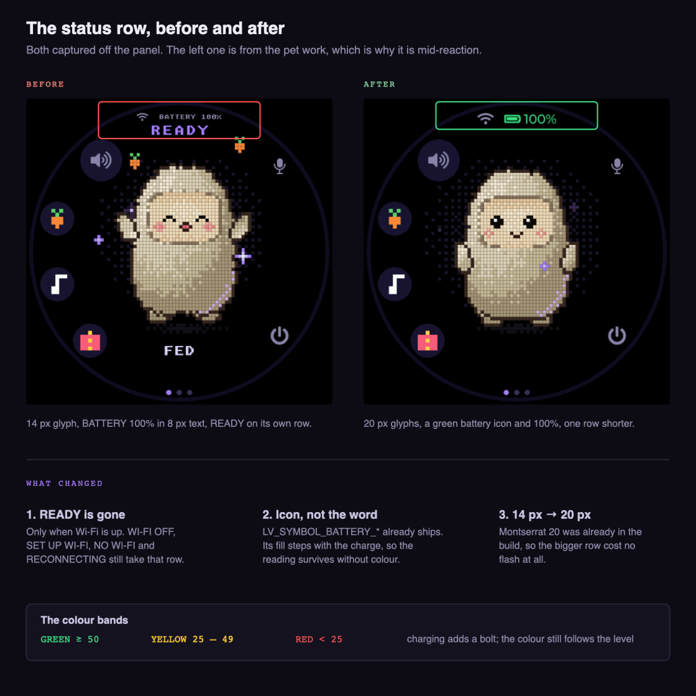
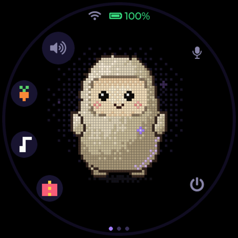

# The first page's status row

**Status:** working
**Branch:** `feat/status-row` — merged to `main` in #6
**Last updated:** 2026-11-03 (battery part superseded the same day)

## Goal

Free the row `READY` was taking, say the battery with an icon rather than a
word, and make both status icons big enough to read at arm's length.

## Before and after

The "before" capture is from the pet work, which is why Jolly is mid-reaction;
it is the same status row either way.

## Decisions

Taken 2026-11-03, from the mockup
(<https://claude.ai/artifact/X3jsXCNsMqYkT1zQPZYpkP>).

- **`READY` goes, but only when Wi-Fi is up.** `idle_name()` returns `""` for
  `MUSE_WIFI_CONNECTED` and keeps `WI-FI OFF`, `SET UP WI-FI`, `NO WI-FI` and
  `RECONNECTING` exactly as they were. Deleting the label outright would have
  taken the only words that say the network is missing — the Wi-Fi glyph
  vanishing is easy to miss on a black panel.
- **20 px, not 28.** Chosen on the mockup against both. 28 is in the build too,
  but it crowds the speaker button, which is the same mistake the pet buttons
  made (see [pet.md](pet.md)).
- **The icon's fill level carries the reading, not just the colour.** Red and
  green are the pair hardest to tell apart, so `LV_SYMBOL_BATTERY_*` steps
  down with the charge and the state survives in grey.

## The colour bands

The bands are unchanged, but the hexes moved when the drawn icon replaced the
symbol — see [battery.md](battery.md).

| Band | Range | Hex |
|---|---|---|
| Green | 50 and up | `#4ade80` |
| Yellow | 25 – 49 | `#ffd060` |
| Red | under 25 | `#ff5252` |

Charging shows a bolt; the colour still follows the level, so a charging flat
battery is a red bolt, not a green one.

**Superseded in part.** The `LV_SYMBOL` battery this file describes lasted one
day: [battery.md](battery.md) replaced it with a drawn 40 x 22 widget whose
fill is proportional rather than stepped, and the bolt moved inside the icon.
What still stands here is the rest of the row — `READY` clearing only when
Wi-Fi is up, the 20 px icons, and why the row had to leave `unscii_8`.

## Findings

- **The row had to change font, not just size.** It carried
  `lv_font_unscii_8`, which has no `LV_SYMBOL` glyphs at all — the battery
  icon is only possible in a Montserrat — *(how: the symbols are defined over
  the Montserrat ranges; unscii is a plain 8 px bitmap face)*.
- **The bigger row costs no flash.** Montserrat 14, 16, 20 and 28 were already
  compiled in for this board, so `FONT_STATUS` picks 20 without adding a face.
  The image stayed at 3,477,504 bytes — *(how: compared the build output
  before and after)*.
- **Small screens are left alone.** `s_small` boards keep the 14 px glyphs and
  the `unscii_8` percentage; there is no room there for either change.

## Open questions

- The charging bolt has not been seen on the panel. The board reports 100 %
  on USB, so it never entered the charging state during testing.
- Whether the freed row should stay empty or take something else. It is empty
  now, which makes the face sit alone under the icons.

## References

- `esp32/components/muse/muse_ui.c` — `FONT_STATUS`, `idle_name()`,
  `update_power()`. The colour constants are now `COLOR_BATT_RED` /
  `_YELLOW` / `_GREEN`; this file's original `COLOR_BATT_OK` / `_LOW` /
  `_FLAT` are gone.
- `esp32/components/muse/muse_settings_ui.c` — where `LV_SYMBOL_CHARGE` and
  `LV_SYMBOL_BATTERY_FULL` were already in use
