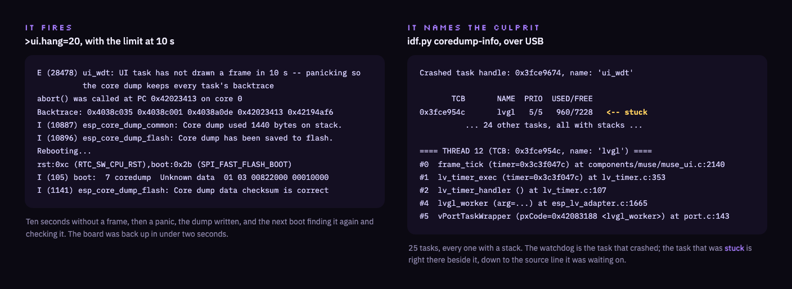
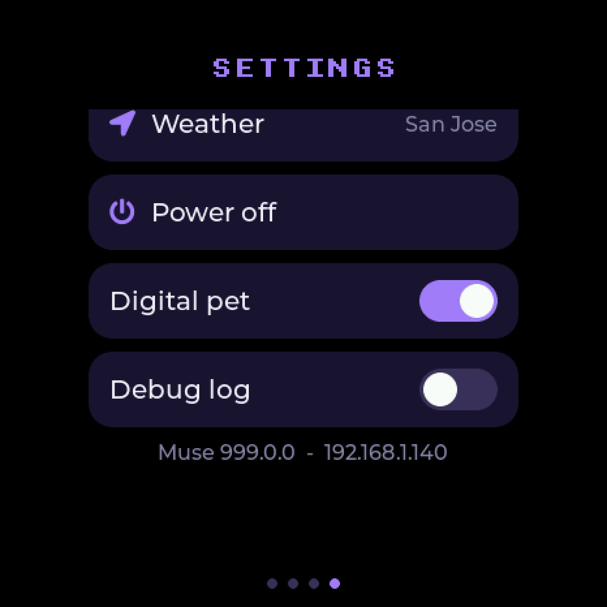

# A frozen screen that leaves something behind

**Status:** working
**Branch:** `feat/ui-hang-diagnosis`
**Last updated:** 2026-11-20

## Goal

When the screen freezes, be able to find out why. Today it cannot be done at
all, and that is not an oversight in one place but three of them lining up.

## What happened

Rax's gadget froze on 2026-11-19 — the screen stopped and swiping did nothing.
It was plugged into the laptop to look at. **Opening the serial port reset the
board**, and the state was gone before a single byte could be read:

```
@power {"boot":"usb","uptime":2,...}
```

`ESP_RST_USB`. That is this hardware, not a mistake in the capture: the comment
in `muse_battery.c` already says *"Plugging back in resets some boards once
their port opens."*

Nothing had been kept, and nothing could have been:

- **`CONFIG_ESP_INT_WDT=n` and `CONFIG_ESP_TASK_WDT_EN=n`** — both off, so a
  wedged task hangs forever rather than resetting. `sdkconfig.defaults` gives
  the reason: PSRAM cache stalls can outlast the int-WDT's 300 ms window.
- **No coredump partition**, so a panic stored nothing either.
- **The RTC record that does survive a reset is rewritten at the start of every
  boot**, and by then there had been three.

A freeze was, by construction, undiagnosable after the fact.

## The task watchdog would not have caught it

Worth stating plainly, because it is the obvious first answer and it is wrong.
The reason given for disabling the watchdogs is about the **interrupt**
watchdog, whose window is 300 ms; the **task** watchdog is a different
mechanism with a 5 s default, which a cache stall will not trip. The two look
conflated.

But turning it back on still would not have caught this one. The task watchdog
watches the **idle** tasks, and a UI task blocked on a mutex leaves idle running
perfectly happily. It catches a task that spins, not a task that waits — and
waiting is what a deadlocked screen does.

## What was built

Five pieces, each useless without the others.

1. **A coredump partition** in `partitions_muse.csv` (`0x822000`, 512 KB) and
   `partitions_muse_8mb.csv` (`0x7E2000`, 64 KB). Both sit after the app slots
   and the product data, so nothing above them moves and no existing board's
   layout shifts. There was room to spare: the 16 MB table ends at 8.13 MB.
   The backtraces alone fit in 64 KB; the 16 MB table is eight times that so
   it can also hold the DRAM capture described in piece 4, which the 8 MB
   table has no room for.
2. **`CONFIG_MUSE_UI_WATCHDOG`** (`muse_ui_watchdog.c`), which watches the one
   thing that actually stops — the LVGL frame timer. `frame_tick()` bumps a
   counter; a priority-1 task checks it every second and panics after
   `CONFIG_MUSE_UI_WATCHDOG_S` seconds without movement. Default off; on for
   `muse-waveshare-s3-175c` at 10 s.
3. **`>ui.hang=<secs>`**, a bench-only console verb that blocks the UI task, so
   the watchdog can be proved to fire without waiting for a real freeze.
4. **`CONFIG_MUSE_CRASH_LOG`** (`muse_crash_log.c`), the words to go with the
   backtraces. The backtrace says where the firmware stopped and nothing about
   what it was doing on the way there; that is in the console log, which exists
   only while somebody is capturing the port -- which, for a gadget in a
   pocket, is never. So the log is mirrored into an 8 KB ring in `.bss`, and
   `CONFIG_ESP_COREDUMP_CAPTURE_DRAM` makes the dump store `.bss` whole. The
   ring has to be internal RAM: the dump skips PSRAM, which is also why
   `main/diagnostic_log.c`'s 16 KB PSRAM ring is no use here (it is never
   installed in this firmware either, and keeps only `link.*` lines).
   `>crashlog` prints it without a dump at all.
5. **A "Debug log" switch** in Settings (`muse_settings_debug_log`), which
   raises every tag to `ESP_LOG_DEBUG` so the ring carries more than the
   INFO-level story. It needed `CONFIG_LOG_MAXIMUM_LEVEL_DEBUG` to be of any
   use -- see the findings -- and it is a bench tool, not a setting to leave
   on. `>debuglog` and `>debuglog=1` work it from the port.

The watchdog holds off while LVGL is paused on purpose — the screen asleep on
battery, or the camera view open. A board that reboots itself every time the
screen sleeps would not be a diagnosis, it would be a new bug.

## Findings



- **The whole chain works end to end** — *(how: `>ui.hang=20` on the board with
  the limit at 10 s)*. The watchdog fired at exactly 10 s, panicked, wrote the
  dump, rebooted, and the next boot found the partition and verified the
  checksum. Back up in under two seconds.
- **The dump names the stuck task and the line it stopped on** — *(how:
  `idf.py coredump-info` over USB)*. 25 tasks, every one with a stack. The
  crashed task is `ui_wdt`; thread 12 is `lvgl`, stopped at
  `frame_tick ... muse_ui.c:2140`. In a real deadlock that frame is whatever
  the UI task was waiting on.
- **Reading the dump back needs `--parttable-off 0x10000`** — *(how: the first
  attempt failed)*. This project moved the partition table off the IDF default
  at `0x8000` (`sdkconfig.defaults` says why: a Secure Boot V2 bootloader grows
  past the `0x6000` ceiling). `esp_coredump` does not know that and reads the
  wrong place. `idf.py coredump-info` has no such flag, so with the dump still
  in flash it is the `esp_coredump` module directly:

  ```
  python -m esp_coredump --chip esp32s3 --port /dev/cu.usbmodem1101 \
      info_corefile --parttable-off 0x10000 --save-core core.elf \
      build-muse-waveshare-s3-175c/muse-gadget.elf
  ```

  and then `idf.py -B <build> coredump-info --core core.elf` for the symbolised
  output, which is where the task names come from.
- **Flash cost is about 66 KB** — *(how: measured)*. The bench image went from
  3,739,648 to 3,805,184 bytes, 3.63 MB of the 4 MB slot.

### The log the dump carries, 2026-11-19



- **A runtime switch alone would have shown nothing** — *(how: read
  `build-.../sdkconfig`)*. The image was built with
  `CONFIG_LOG_MAXIMUM_LEVEL=3`, so every `ESP_LOGD` in it was compiled out and
  no `esp_log_level_set` call brings one back. The ceiling has to go up at
  build time, which is the one rebuild this feature needs; after it the switch
  is runtime for good. Raising it cost nothing measurable — the image is
  3,805,184 bytes either way, 384 KB still free in the slot — because the
  Wi-Fi debug strings are in Espressif's prebuilt libraries and are not
  rebuilt.
- **Raising our own components' ceiling would have been pointless** — *(how:
  counted)*. `components/muse` and `components/muse_radio` hold two
  `ESP_LOGD` calls between them and no `ESP_LOGV`. Everything the switch
  reveals belongs to IDF: 508 debug lines in one boot, from `nvs`, `wifi`,
  `event`, `i2s_common` and `vfs_calls`.
- **The ring works and wraps** — *(how: `>crashlog` on the board)*. 7,145
  bytes and 124 lines after a quiet boot, the first being `muse: board:
  Waveshare ESP32-S3-Touch-AMOLED-1.75C`; 8,192 bytes and 147 lines with the
  switch on, 94 of them `D`, the oldest dropped. It starts at
  `muse_app_run()`, so the bootloader and Home Link's first lines are not in
  it.
- **Turning the switch on crashed the board, twice over** — *(how: it did)*.
  `***ERROR*** A stack overflow in task lcd_send`. `spi_master` logs twice per
  bus transaction at DEBUG, from inside `lcd_send`, whose stack had no room
  for it -- and the ring's hook, which formats the line on the caller's stack,
  was making it worse at 256 bytes. The hook's buffer is now 128 bytes and
  `spi_master` is pinned back to INFO whenever the switch goes on. With both,
  the board runs with debug logging on and still boots in one go.
- **And then it would not come back** — *(how: the port stopped enumerating)*.
  The switch is stored in NVS, so the panic rebooted into the same setting and
  crashed again: a boot loop with no way out but catching a flash window
  between resets (it took three tries). `muse_app_run` now clears the switch
  when the last reset was a crash, so one crash disarms it.
  A diagnostic that can brick the thing it diagnoses is worse than none.
- **A panic on this board does not report `ESP_RST_PANIC`** — *(how: the
  disarm did not fire until the check was widened)*. With
  `esp_reset_reason() == ESP_RST_PANIC` the switch stayed on through a
  confirmed watchdog panic and core dump; with the whole crash set
  (`PANIC`, `INT_WDT`, `TASK_WDT`, `WDT`, `UNKNOWN`) the next boot cleared it,
  `>debuglog` reading 0. Both watchdogs are compiled out of this firmware, so
  by elimination the reason is `ESP_RST_UNKNOWN` — inferred, not read: the
  boot that would say so is the one that opening the port destroys.
- **`>ui.scroll=<px>`** was added alongside, bench-only, because the settings
  page cannot be dragged from the port and every row worth a screenshot is
  below the fold.

## Still open

- **The original freeze is still unexplained**, and this does not explain it —
  it only means the next one will explain itself. There are around thirty
  unbounded `xSemaphoreTake(..., portMAX_DELAY)` waits across the `muse`
  components; any one held by a stuck task, while the UI task waits for the
  LVGL lock, gives exactly the symptom.
- **The radio and podcast pages were checked and cleared** — *(how: read)*.
  `teardown()` is bounded to 40 × 25 ms, `reap()` only deletes workers that
  have already signalled done, and `muse_radio` has no `portMAX_DELAY` at all.
  That page can stall the screen for about a second; it cannot freeze it.
- **The watchdog is off for every other board.** It panics, which is a
  behaviour change, so the boards it has not been tried on do not get it by
  default.
- **Nothing reads the dump on its own.** It waits in flash until someone asks.
  Posting it to Hatch on the next boot would be the obvious next step.
- **The 8 MB boards get backtraces only.** `partitions_muse_8mb.csv` has
  56 KB of slack above its coredump partition, not the 128 KB the DRAM capture
  wants, so `CONFIG_ESP_COREDUMP_CAPTURE_DRAM` is set in the
  `muse-waveshare-s3-175c` profile rather than in `sdkconfig.muse`. Those
  boards keep the ring in RAM and `>crashlog`; they just cannot read it back
  after the fact.
- **Debug logging is still something to hold at arm's length.** One tag has
  been pinned back because it crashed the board; there is no reason to think
  `spi_master` is the only driver that logs from a task with a tight stack.
  The switch is for a board on a bench with the port open.

## References

- Files: `esp32/components/muse/muse_ui_watchdog.{c,h}`,
  `esp32/components/muse/muse_crash_log.{c,h}`,
  `esp32/components/muse/muse_app.c` (the panic disarms the switch),
  `esp32/components/muse/muse_settings.{c,h}`,
  `esp32/components/muse/muse_settings_ui.c` (the switch),
  `esp32/components/muse/muse_ui.c` (`frame_tick`),
  `esp32/components/muse/muse_input.c` (`>ui.hang=`, `>ui.scroll=`,
  `>crashlog`, `>debuglog=`),
  `esp32/partitions_muse.csv`, `esp32/partitions_muse_8mb.csv`,
  `esp32/devices/sdkconfig.muse`,
  `esp32/devices/sdkconfig.muse-waveshare-s3-175c`
