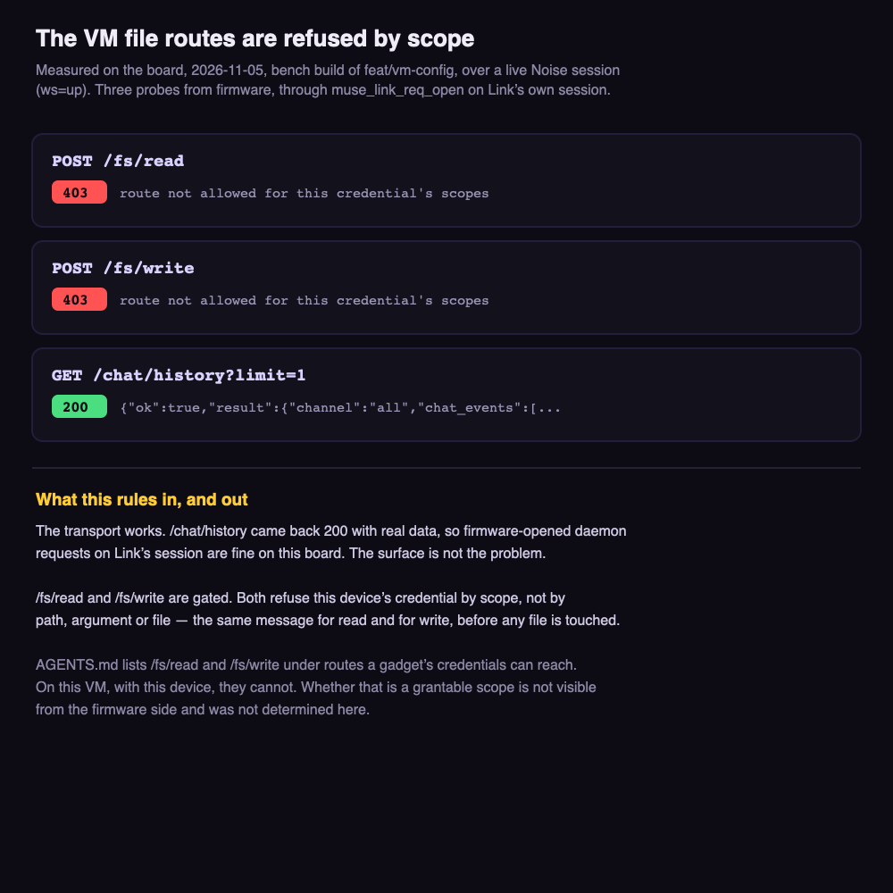

# Settings kept on the user's VM

**Status:** blocked
**Branch:** `feat/vm-config`
**Last updated:** 2026-11-05

## Goal

Keep a feature's settings as a file on the user's VM instead of only in the
firmware, so Muse can read and change them in conversation — "set my radio
stations to ICRT and Hit FM" — and the gadget picks the change up. The
firmware keeps its defaults and seeds the VM with them the first time, so
there is always something to reset back to.

Rax's shape, 2026-11-05:

1. Defaults live in the firmware, as now. The VM is where they go to be
   edited, not where they come from. If the VM has no settings on the first
   query, the gadget writes its defaults up.
2. Build it on a branch that compiles, so it can be reverted if it goes wrong.

## What was measured

Flashed as a bench build on the Waveshare 1.75C over a live session
(`ws=up`), driven from the serial console with `>vmcfg`:

| Route | Status | Reply |
|---|---|---|
| `POST /fs/read` | **403** | `route not allowed for this credential's scopes` |
| `POST /fs/write` | **403** | `route not allowed for this credential's scopes` |
| `GET /chat/history?limit=1` | **200** | `{"ok":true,"result":{"channel":"all",...` |

- **The transport works.** `/chat/history` returned real data, so firmware
  opening its own HTTP requests on Link's Noise session
  (`muse_link_req_open`) is fine on this board. The daemon-request surface is
  not the problem — *(how: the third probe above)*.
- **`/fs/read` and `/fs/write` are gated by credential scope.** Both refuse
  with the same message, before any file is touched, so it is not the path,
  the arguments or a missing file. Read and write are refused alike — *(how:
  the first two probes)*.
- **The documentation and this VM disagree.** `esp32/AGENTS.md` lists
  `POST /fs/read` and `POST /fs/write` under "Routes a gadget's credentials
  can reach". On this VM, with this device, they cannot. Whether that scope
  can be granted is **not visible from the firmware side and was not
  determined here** — it is an account or VM-side question.

## Blockers

- **Blocked on a credential scope, not on code.** The module is written,
  compiles and runs; it gets a 403. Nothing in the firmware can lift that.
  Next step is to find out whether the `/fs` scope can be granted to a
  gadget's device token, which means asking on the Muse/VM side rather than
  in this repo.

## What is on the branch

Written and building, waiting only on the scope:

- `esp32/components/muse/muse_vm_config.{c,h}` — `read`, `write` and `load`
  (read, and seed from the firmware's defaults when the VM has none, which is
  point 1 above). Blocking calls, documented as needing a task of their own:
  the reply callback runs on the session task, so calling from there would
  deadlock.
- `>vmcfg` on the serial console — the round trip and the three probes, which
  is what produced the table above.

## Open questions

- **Can the `/fs` scope be granted?** If yes, this is finished work. If no,
  the idea needs a different carrier.
- **`/chat/history` as the carrier instead?** It is reachable today. Muse
  could put a settings line in the chat and the gadget could read it back.
  Workable but unpleasant: it mixes configuration into conversation, and
  there is no write side — the gadget could not seed its defaults, which is
  half of point 1.
- The reply buffer here is 2 KB (`REPLY_MAX`); `/chat/history` overran it in
  the probe. Anything that really reads chat needs the bound AGENTS.md
  describes, or `?limit=1` plus a bigger buffer.

## References

- `esp32/AGENTS.md` — "Requests to Muse's VM from your code": the routes, the
  JSON bodies and the session's size bounds
- `esp32/main/noise_control.h` — `noise_ctrl_req_open`, and the inbound
  command callback that would be the other direction
- `esp32/main/image_fetch.c` — the working precedent for fetching from the VM
  over this session (`display.draw_file`)
- [music.md](music.md) — route 2 (internet radio and podcasts) is the feature
  that wanted this; its station list is the setting this was for. The radio
  page's own plan is not written yet.
