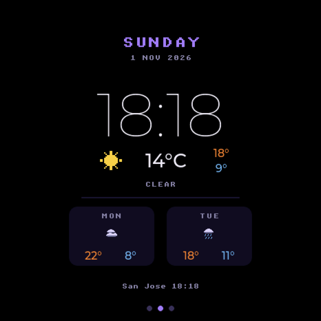
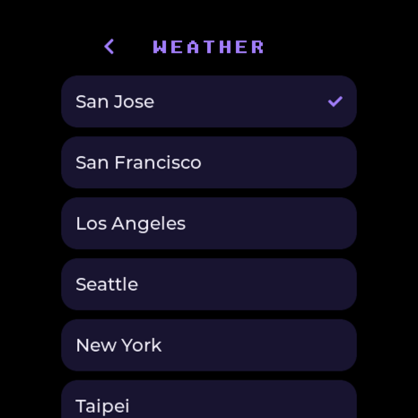
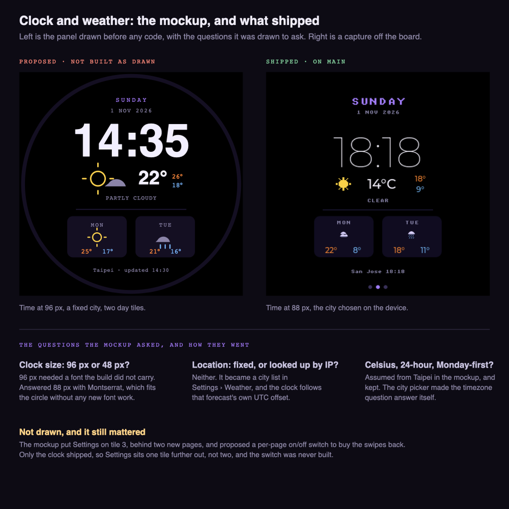

# Clock and weather

**Status:** working
**Branch:** `feat/clock-weather` — merged to `main` in #1 and #3
**Last updated:** 2026-11-01

## Goal

An idle page showing the time and current conditions.

## What it looks like

The page itself, captured off the panel:

Weekday and date, the time at 88 px, then the current sky icon, temperature and
today's high/low, a one-word description, and two day tiles. The footer carries
the chosen city and the time its forecast arrived.

The city is picked in `Settings > Weather`:

## What was proposed, and what it became

The page was drawn before any code, as a panel with three open questions on
it. None of the three was answered the way the mockup assumed:

The mockup is here because the shipped page does not explain itself: it does
not say why the time is 88 px rather than filling the circle, or why there is
a city list at all. Both were decisions, and this is what they were decided
against.

## Plan

1. ~~Pick a keyless forecast API.~~ Open-Meteo.
2. ~~Build the page on the tileview, between the character and settings.~~
3. ~~Fetch and parse the forecast on its own PSRAM task.~~
4. ~~Get the time, and make it survive sleep.~~ SNTP.
5. ~~Make the page a drop-in folder other people can copy.~~
6. ~~Let the city be chosen on the device rather than at build time.~~

## Findings

- **Open-Meteo needs no key and no account**, so nothing secret has to live on
  the device — *(how: fetched it from the board; `weather: 14 deg now, today
  18/9, offset -28800 s`)*.
- **`timezone=auto` returns `utc_offset_seconds` with the forecast**, so the
  clock follows the chosen city with no second setting and no timezone
  database — *(how: the offset above is UTC−8, correct for San Jose in
  November)*.
- **A Kconfig `bool` that is off is undefined, not 0.** `#if CONFIG_FOO` fails
  to compile rather than evaluating false. Guard with `#ifdef` and define an
  int — *(how: the build broke on `CONFIG_MUSE_CLOCK_FAHRENHEIT`)*.
- **lvgl's component name is `lvgl__lvgl`, not `lvgl`.** Requiring `lvgl`
  directly fails to resolve; require `muse`, which re-exports it as a public
  dependency — *(how: the build error named it)*.
- **`lv_font_unscii_16` has no U+00B0**, so the degree sign drew as a box. The
  temperature labels use `lv_font_montserrat_16` — *(how: looked at the
  screenshot)*.
- **A page's `settings_build` cannot assign the slot `on_nav` shows.** The
  firmware's own pages do it inside their build function; a plugin's build
  takes a tile and returns nothing, so the slot stayed NULL and `show(NULL)`
  rebooted the board. `muse_settings_ui_page()` now files the page it makes —
  *(how: tapping Weather restarted the device, every time)*.
- `board.sh flash` does not rebuild. Always `build` then `flash`, or you are
  testing the previous image — *(how: a debug line that never appeared)*.
- **`snap.py`'s optional `reset_wait_s` argument resets the board**, so any
  on-device state set by an earlier call is gone. Pass it on the first call
  only — *(how: a two-step navigation kept landing back on the character
  tile)*. `>ui=settings` then `>ui.sub=<n>` drives into a plugin's settings
  page for screenshots.
- Any HTTPS host needs
  `CONFIG_MBEDTLS_CERTIFICATE_BUNDLE_CROSS_SIGNED_VERIFY=y` if its chain is
  cross-signed — see [voice.md](voice.md). Open-Meteo did not need it, but
  check this first if a fetch fails before suspecting the code.

## Blockers

None.

## Open questions

- Open-Meteo's free tier is non-commercial. Fine as this is; worth remembering
  if it ever ships in something sold.
- The 20-minute refresh was chosen, not measured. Nobody has checked what an
  always-on idle page costs in battery.

## References

- `esp32/components/muse_clock/` — the whole feature, as a drop-in component
- `esp32/components/muse_clock/README.md` — how someone else installs it
- `esp32/components/muse/muse_page.h` — the registration seam it rides on
- `esp32/components/muse/muse_settings_ui.c` — `muse_settings_ui_page()` and friends
